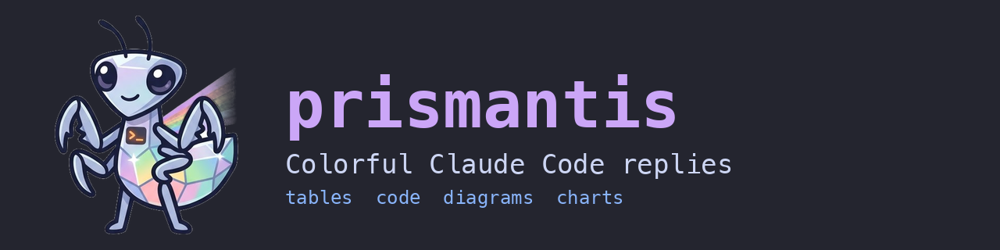
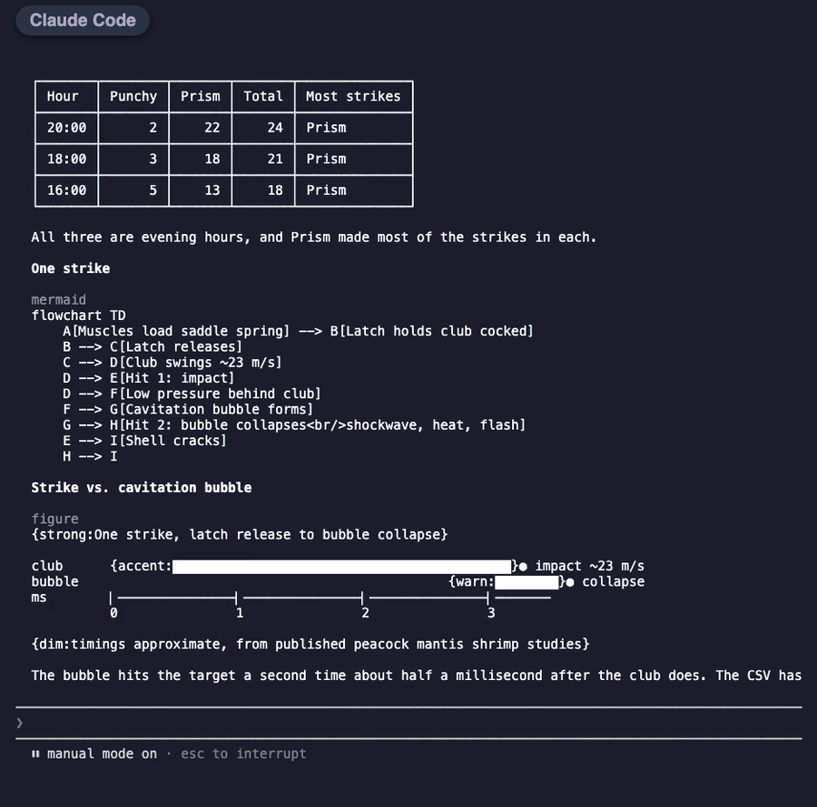
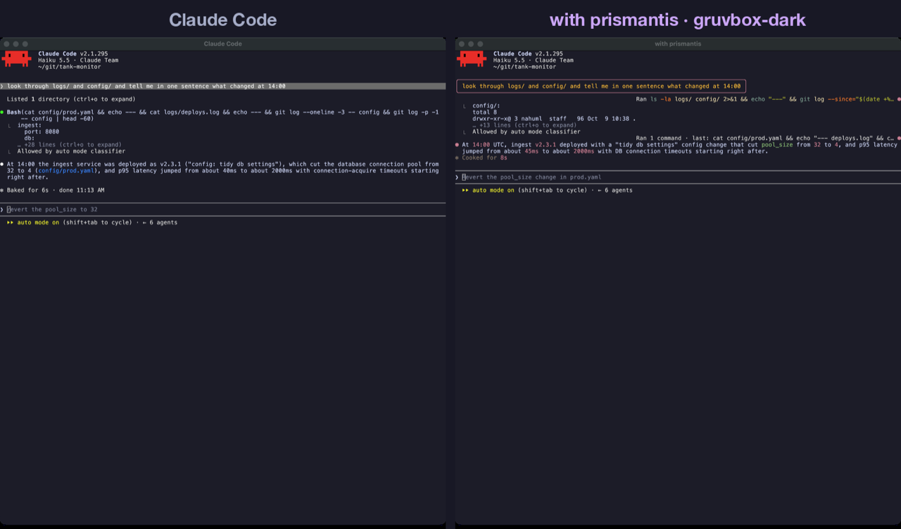
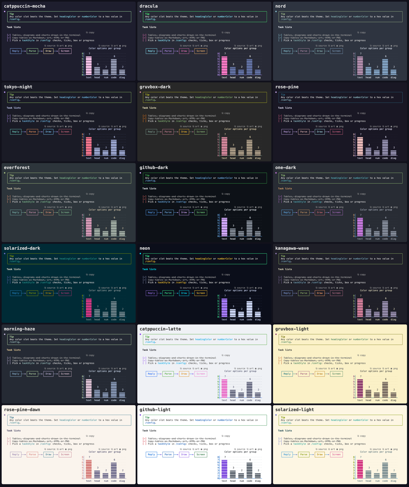

<h1 align="center"></h1>

<p align="center"><em>Sees 16 colors. Your terminal only had 8.</em></p>

<p align="center">
  <a href="https://github.com/NahumLitvin/prismantis/releases"></a>
  <a href="https://github.com/NahumLitvin/prismantis/actions/workflows/ci.yml"></a>
  <a href="LICENSE"></a>
  
  <a href="https://github.com/hesreallyhim/awesome-claude-code"></a>
  <a href="https://statuslin.es/mods/prismantis"></a>
</p>

<p align="center">
  <a href="#install"><strong>Install</strong></a> ·
  <a href="#also-runs-in">Other hosts</a> ·
  <a href="#faq">FAQ</a> ·
  <a href="#docs">Docs</a> ·
  <a href="docs/CHANGELOG.md">Changelog</a>
</p>

Claude Code prints mermaid as source, tables as pipes and tool calls as walls of text. **prismantis draws them**: real charts and flowcharts, colored tables and code, chat bubbles and quiet tool rows, in 18 themes. Built for Claude Code, and it also runs in OpenCode, Codex and Antigravity.



<sub>One real reply: Claude Code's plain markdown, then prismantis. <a href="https://www.catchkill9.dev/video/prismantis-tour.mp4">▶ This clip as video</a> · <a href="https://www.catchkill9.dev/video/prismantis-why.mp4">▶ The 1:44 film</a></sub>

## Install

In Claude Code 2.1.287 or later:

```
/plugin marketplace add NahumLitvin/prismantis
```

```
/plugin install prismantis@prismantis
```

Then `/prismantis setup` picks a theme and the five main styles from drawn samples, and `/prismantis demo` shows every feature.

## What you get

- **Charts and diagrams** from mermaid: flowcharts, sequence, state and ER diagrams, bar, line and pie charts, gantt and more, one color per box.
- **Tables** with colored headers, aligned numbers and rules, sized to the terminal.
- **Code** with a language header and Prism highlighting in two dozen languages.
- **Chat layout**: your prompts on the right in a bubble, Claude's replies on the left.
- **Tool rows** that say what Claude did, `Ran npm test`, `Read src/app.ts`, with diff cards for edits.
- **Copy buttons** on tables, code, diagrams and replies: markdown, text art, HTML or PNG.
- Also [figures](docs/diagrams.md#figures), [LaTeX math](docs/diagrams.md#latex-math) in kitty and Ghostty, [right-to-left text](docs/appearance.md#right-to-left) and [full desktop app themes](docs/appearance.md#full-app-themes-for-claude-code-desktop).



<details>
<summary><strong>All 18 themes</strong>, thirteen dark and five light</summary>



</details>

## Also runs in

Claude Code gets everything. The other hosts draw replies themselves, so prismantis tells the model what the host can draw (tables, diagrams, figures) and adds what each plugin API allows:

| Host | What prismantis adds | Install |
|---|---|---|
| **OpenCode** 2.2.5+ | figures in color, the mermaid charts OpenCode leaves as source, themes for code and prose | [opencode/README.md](opencode/README.md) |
| **Codex** 0.169.0+ | themes for code, prose, tables and diagrams; figures as text pictures | [codex/README.md](codex/README.md) |
| **Antigravity** | a `/prismantis` demo; no themes, Antigravity keeps its own colors | [antigravity/README.md](antigravity/README.md) |

Side by side: [docs/compatibility.md](docs/compatibility.md).

## Make it yours

`/prismantis setup` walks every style with a preview. The options most people change:

| Option | Default | What it does |
|---|---|---|
| `theme` | `catppuccin-mocha` | one of 18 palettes, `mono` or `random`; `/prismantis theme nord` switches on the spot |
| `promptStyle` | `bubble` | your prompts on the right like a chat app; also `framed`, `wide`, `bar`, `chevron` or `off` |
| `tableStyle` | `box` | `box`, `rules`, `grid` or `minimal` |
| `toolOutput` | `full` | `quiet` hides what reads and searches returned; `rows` also hides the output of calls that worked. Both keep edit diffs and errors |
| `diagramHints` | `true` | tells Claude the terminal draws charts, so it reaches for them (about 630 tokens per prompt) |
| `desktopColors` | `off` | `match` paints the whole desktop app Code tab in the theme (2.1.324+) |

Set them in `/config`, or under `pluginConfigs["prismantis@prismantis"].options` in `~/.claude/settings.json`. All 80 options: [docs/configuration.md](docs/configuration.md).

## FAQ

**Does it send my data anywhere?** No. prismantis makes no network calls. It runs a program in two cases only: the clipboard helper when you click `⧉ html` or `▣ png`, and RaTeX's renderer once you turn LaTeX on. The full list: [what it runs, reads and changes](plugin/README.md#what-it-runs-reads-and-changes).

**What does it cost in tokens?** With `diagramHints` on (the default), about 630 tokens of model-only context per prompt, plus about 35 on your first prompt and every tenth after it for the issue hint. Set `diagramHints` and `issueHint` to `false` to drop both. Breakdown: [docs/model-hints.md](docs/model-hints.md).

**Will it slow Claude Code down?** No. prismantis lays out the full demo reply in about 5 ms cold and 1 ms warm on an M4 Pro. Check it on your machine with `npm --prefix scripts run bench`.

**Which terminals work?** Any terminal Claude Code runs in; CI tests on macOS, Linux and Windows. The desktop app, VS Code and mobile use the same mod API. LaTeX math needs kitty or Ghostty outside tmux; round pies draw as an image there and as text elsewhere. A diagram too big for the window falls back to its source, never to garbage.

**How do I update, turn it off or remove it?** Update with the command below, then `/reload` in each open session. Turn it off in `/plugin` and Claude Code's own renderer comes back at once. Remove it with `claude plugin uninstall prismantis@prismantis`.

```bash
claude plugin marketplace update prismantis && claude plugin update prismantis@prismantis
```

**Something drew wrong?** [Troubleshooting](docs/troubleshooting.md) covers the common cases. Otherwise [open an issue](https://github.com/NahumLitvin/prismantis/issues) with the markdown that broke.

## Docs

[Appearance](docs/appearance.md) (themes, prompts, code, text, lists, RTL) · [Tables](docs/tables.md) · [Diagrams, figures and math](docs/diagrams.md) · [Copy buttons](docs/copying.md) · [Tool output](docs/tool-output.md) · [Model hints](docs/model-hints.md) · [Configuration](docs/configuration.md) · [Troubleshooting](docs/troubleshooting.md) · [Develop and other mods](docs/development.md) · [Roadmap](https://github.com/users/NahumLitvin/projects/2)

<details>
<summary>For LLMs and agents</summary>

To change the code, read [AGENTS.md](AGENTS.md) instead.

- **What it is:** a Claude Code mod (function hooks in TypeScript) that redraws assistant replies, slash-command output, tool rows, the turn footer and user prompts. With `diagramHints` on (the default) it also adds model-only notes to each prompt; [docs/model-hints.md](docs/model-hints.md) lists them and their cost.
- **Install:** `/plugin marketplace add NahumLitvin/prismantis`, then `/plugin install prismantis@prismantis`. Needs Claude Code 2.1.287+. Changes apply after `/reload`.
- **Configure:** every option is a key under `pluginConfigs["prismantis@prismantis"].options` in `~/.claude/settings.json`, documented in [docs/configuration.md](docs/configuration.md); the machine-readable source is `userConfig` in [plugin/.claude-plugin/plugin.json](plugin/.claude-plugin/plugin.json).
- **Side effects:** no network. Programs it runs: the `⧉ html` and `▣ png` clipboard helper (`/usr/bin/osascript` on macOS, `powershell.exe` on Windows, `copyq` on Linux for `⧉ html` only, only on a click, with a 5 second timeout (15 on Windows) that grows with the copy size up to 30), and `ratex-render` while `latex` is on. With `diagramHints` on, it adds about 630 tokens of model-only context (about 710 while `latex` is on) to each prompt you type and each prompt another plugin sends, as broken down under [Diagram hints](docs/model-hints.md#diagram-hints). With `keyPointHint` on, it adds about 80 more.
- **Turning it off:** `"enabled": false`, or disable the plugin in `/plugin`. `"surfaces": "terminal"` keeps it in one app.
- **For other mods:** `$.prismantis.markdown({ surface, text, columns })`, see [docs/development.md](docs/development.md#other-mods).

</details>

## Author

Built by [Nahum Litvin](https://github.com/NahumLitvin), who writes about running untrusted code in production at [catchkill9.dev](https://www.catchkill9.dev/). Contributions welcome: see [CONTRIBUTING.md](.github/CONTRIBUTING.md).

## License

[MIT](LICENSE). Bundled third-party code is listed in [THIRD_PARTY_NOTICES.md](plugin/THIRD_PARTY_NOTICES.md).
