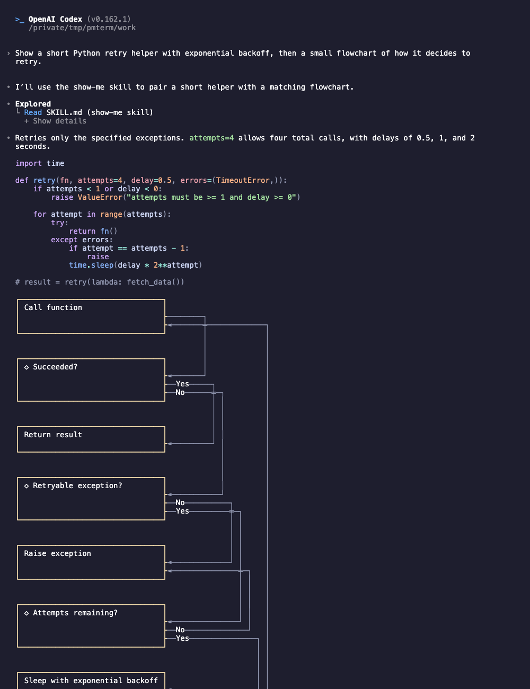
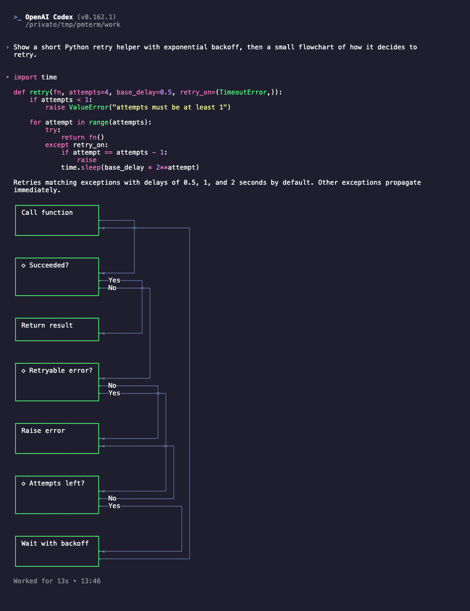

# prismantis for Codex

Codex has no way for a plugin to redraw replies, so prismantis in Codex does two things: it gives Codex the same session note as Claude Code, so replies come back with tables, diagrams and figures, and it ships the 16 prismantis themes as Codex syntax themes.

| Codex alone | With prismantis |
|---|---|
|  |  |

## Install

```bash
codex plugin marketplace add NahumLitvin/prismantis && codex plugin add prismantis@prismantis
```

Trust its hook once in `/hooks`, run `$prismantis-themes` to install the themes, and pick one with `/theme`. `$prismantis` prints the demo.

## What works

Full parity with Claude Code waits on two Codex issues. [openai/codex#53662](https://github.com/openai/codex/issues/53662), theme colors for prose, was accepted: the Codex team closed it as completed on 2026-10-15, and it is not in a Codex release yet. [openai/codex#53663](https://github.com/openai/codex/issues/53663), plugins drawing their own fenced blocks, is open, with a proof of concept in [#113](https://github.com/NahumLitvin/prismantis/pull/113).

| Feature | Codex today | After openai/codex#53662 | After openai/codex#53663 |
|---|---|---|---|
| Code, inline code, table headers and mermaid boxes in the theme colors | ✓ | ✓ | ✓ |
| The session note: tables, diagrams and figures in replies | ✓ | ✓ | ✓ |
| Headings, bold, italic, quotes, lists and links in the theme colors | | ✓ | ✓ |
| Figures and xychart bar and line charts drawn | | | ✓ |
| Copy buttons, tool rows, diff cards, prompt styles, alert boxes, footnotes, right-to-left text | | | |

The themes already carry the prose colors, so they show up as soon as Codex ships #53662. The last row needs Codex to let plugins redraw its interface, as Claude Code does.

This folder is generated from the Claude Code source by `npm --prefix scripts run build:codex`. Edit the source, not these files.
