# Appearance

[← README](../README.md)

## Themes

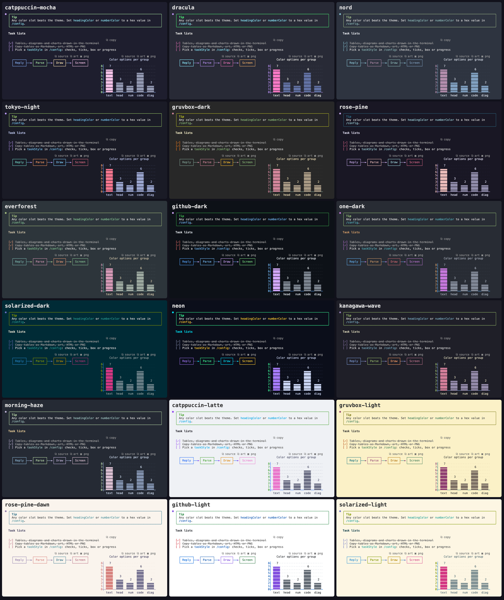

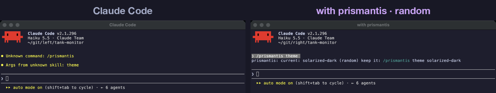

Dark: `catppuccin-mocha` (default), `dracula`, `nord`, `tokyo-night`, `gruvbox-dark`, `rose-pine`, `everforest`, `github-dark`, `one-dark`, `solarized-dark`, `neon`, `kanagawa-wave`, `morning-haze`.

Light: `catppuccin-latte`, `gruvbox-light`, `rose-pine-dawn`, `github-light`, `solarized-light`.

`mono` drops the palette for bold and dim; alerts keep their colors. Switch with `/prismantis theme nord`, or run `/prismantis` for the help screen with every theme. Every palette is MIT licensed and credited in [THIRD_PARTY_NOTICES.md](../plugin/THIRD_PARTY_NOTICES.md).

### Full app themes for Claude Code desktop

In the Claude Code desktop app, prismantis can paint the whole Code tab in the theme, not only the replies: background, panels, text, borders, accent, and the success, warning and danger colors. A light theme switches the app to light mode, a dark one to dark mode. It's off until you turn it on:

1. Update Claude Code to **2.1.324** or later (in the desktop app, the version the Code tab runs).
2. Run `/prismantis setup desktop match`, or set `desktopColors` to `match` in `/config`.
3. Start a new session in the Code tab, or `/reload`. From then on `/prismantis theme <name>` repaints the app as well.

To go back, run `/prismantis setup desktop off` (or set it to `off` in `/config`): prismantis clears its colors once and the app's own look returns. The colors come from each palette through prismantis's own mapper, which holds text to a contrast floor so the app doesn't refuse the theme. Your `*Color` overrides carry over, like `accentColor`.

There's one desktop theme per session, so with `match` on, prismantis and another mod that sets desktop colors or a backdrop replace each other; use one at a time. The terminal, VS Code and older Claude Code versions keep their own colors, and prismantis skips the call there without a message.

## Your prompts

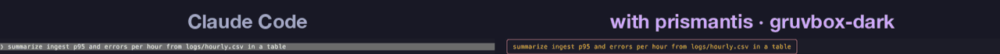

What you type, at the prompt or through Remote Control, draws in the theme's colors. `promptStyle` picks the look, and `off` keeps Claude Code's own. `bubble` draws it on the right like a chat app, as wide as its longest line and at most three quarters of the window, under `You ⬤`, in a rounded frame of the theme's green on a deep green fill, a pale one in a light theme, and Claude's replies in a bubble of their own. `framed` draws it the same way with no fill. The other styles keep Claude's replies as they were. `promptFillColor` and `replyFillColor` change the two fills, and `replyBorderColor` the frame of Claude's. Task notifications and teammate messages are left alone.

| `bubble` (default) | `framed` | `wide` | `bar` | `chevron` |
|---|---|---|---|---|
| 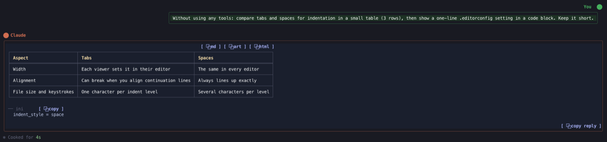 | 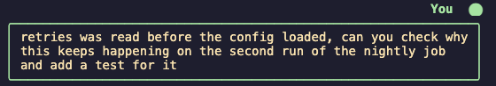 | 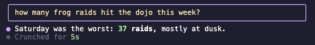 | 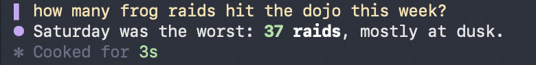 | 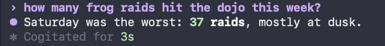 |

`clock` adds the time: each prompt shows when you sent it, and the line that closes each turn when it finished (`✻ Baked for 1m 55s · 14:32`). It reads `24h` or `12h`, and a time from another day gets its date. With `promptStyle: off` the time goes in front of Claude Code's own prompt row. Off by default.

| `clock` | on a prompt | and on a turn's last line |
|---|---|---|
| `24h` | 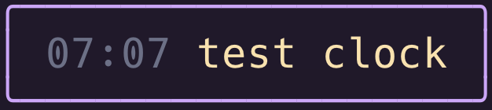 | 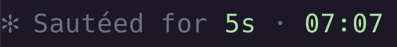 |
| `12h` | 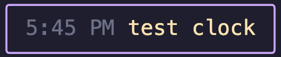 |  |

`replyStyle` does the same for Claude's replies, so the two sides of the conversation read apart at a glance. Its default, `auto`, draws them as `bubble` while your prompts are a `bubble` and as `off` with any other `promptStyle`. `bubble` heads a reply with `⬤ Claude` and draws it in a rounded frame of Claude's orange, as Claude Code's theme draws it, on a midnight blue fill a step off the background, `solid` fills it to the edge with half blocks top and bottom and no frame, `framed` keeps the frame with no fill. A reply that calls tools between its sentences draws one bubble per block of text, and only the first gets `⬤ Claude`. In a theme with no colors to fill with, such as `mono`, `solid` draws the frame. `off` keeps the dot before the first line. `bubbleLabels` sets the `You ⬤` and `⬤ Claude` labels over the bubbles: `large` (the default), `small` with the dot `●`, or `off` for frames alone.

| `bubble` (with `auto`) | `solid` | `framed` |
|---|---|---|
|  | 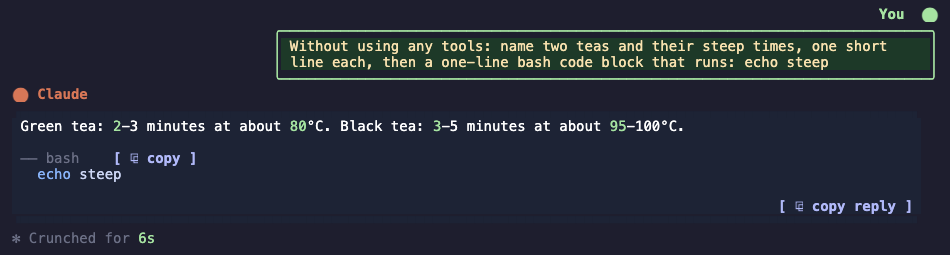 | 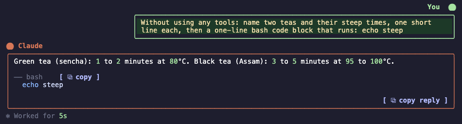 |

`bubbleLabels` sets the labels over the bubbles: `large` draws `You ⬤` and `⬤ Claude` as above, `small` swaps the ⬤ for a `●`, and `off` drops both labels and keeps the frames.

| `large` (default) | `small` | `off` |
|---|---|---|
|  | 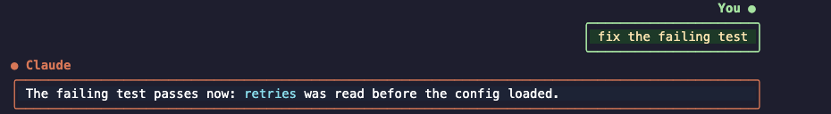 | 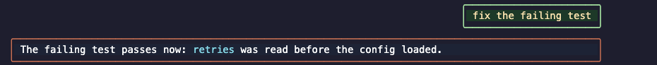 |

## Code

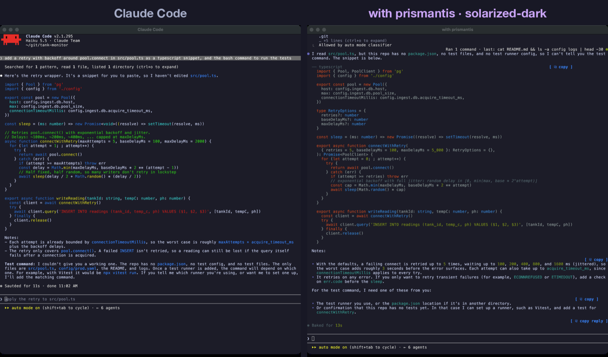

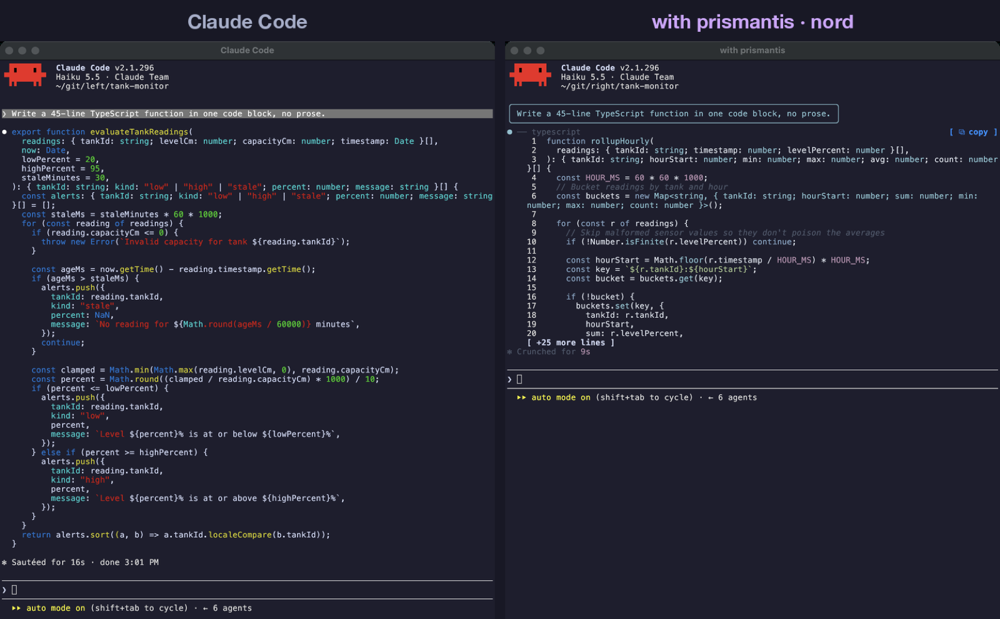

Each code block gets a header row: the language on the left, a copy button on the right. The code sits indented below with no frame, so selecting it with the mouse copies only the code.

`codeStyle` picks the look. `framed` adds a rounded box, whose characters land in a mouse selection, though the copy button leaves them out. `filled` adds a background, or the box in a theme with no colors to fill with, such as `mono`. `card` adds both. `codeBorderColor` and `codeFillColor` change their colors. The terminal draws these styles. Other surfaces keep Claude Code's own code block.

| `plain` (default) | `framed` | `filled` | `card` |
|---|---|---|---|
| 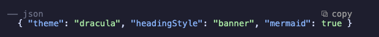 | 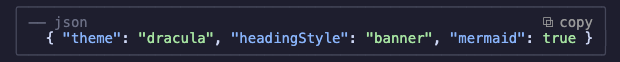 | 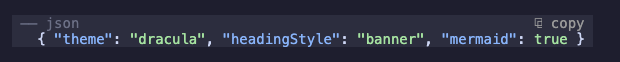 | 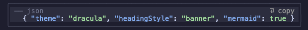 |

- **Prism** highlights JavaScript, TypeScript, JSX/TSX, Python, Go, Rust, Java, Kotlin, Swift, C, C++, C#, Ruby, JSON, YAML, TOML, SQL, HTML, CSS, Dockerfile, HCL, Lua, PHP and diff.
- **Shell** blocks (`bash`, `sh`, `zsh`, `fish`, `powershell`, unlabeled) color the command word, `--flags`, quoted strings and `# comments`, and restart after `|`, `&&` and `;`.

## Text

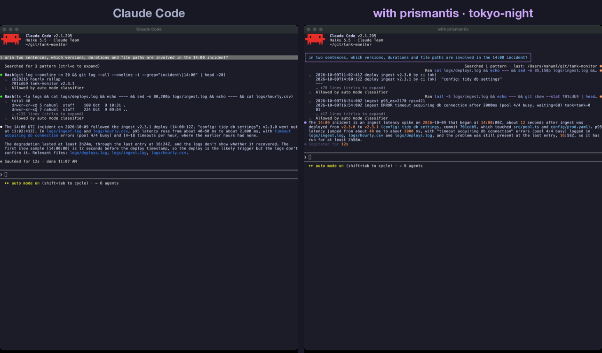

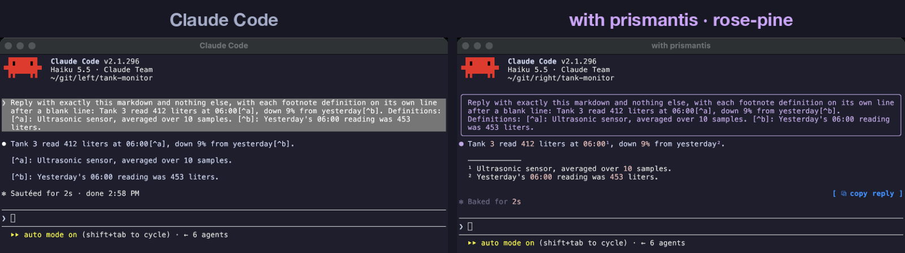

**Bold**, *italic*, ~~strikethrough~~, `inline code`, links and bare URLs, clickable as terminal hyperlinks. Numbers, versions (`v2.14.0`), durations (`250ms`, `3h`), sizes (`16Gi`) and percentages (`99.9%`) take the number color, and paths like `~/src/app.ts` the path color.

Paths open their file or folder on click, as do `file://` links that show their own path, from Claude Code 2.1.289 on. A path that starts with `~/`, `./` or `../` links to its file, with `~` read as your home folder and `./` from the session's project folder. A path that starts with `/` links once it has two parts, like `/tmp/app.ts`, so a slash command like `/config` stays text, and so does a top folder like `/tmp`. A `:12` after a path stays text. The files in tool rows of Claude Code's own file tools (Read, Edit, MultiEdit, Write, NotebookEdit, Grep, Glob) and the headers of shell-edit diff cards link too, a one-part path like `/etc` included, to the whole path even where the row shortens it. A `file://` link shows its own path when its text, apart from trailing punctuation, is the link itself or the path the link opens: `/tmp/a.md`, `C:\Users\me\a.md` and `\\server\share\a.md` as written, or a `~/`, `./` or `../` path read as above. A link with any other text, such as `[the docs](file:///tmp/setup.command)`, draws as `the docs (file:///tmp/setup.command)` in plain text, so a reply cannot hide what a click opens behind a harmless name. Under WSL the link goes through `wsl.localhost`, so Windows Terminal opens the file from the Linux side; a Linux terminal under WSLg (GNOME Terminal, Konsole, kitty) gets plain `file:///` links, which it opens itself. Paths and `file://` links that show their own path link only in a terminal that draws hyperlinks, judged the way Claude Code judges it (`FORCE_HYPERLINK`, Windows Terminal, iTerm2, WezTerm, kitty, Ghostty, VS Code 1.72 and later, and others), so a terminal without them never shows a URL after a path. In a session over SSH (`SSH_CONNECTION` or `SSH_TTY` set) paths and `file://` links stay text, since a file link would open a file on the computer the terminal runs on rather than the one Claude Code runs on. A link longer than the 2048 characters Claude Code draws stays text too. Paths in inline code stay plain, and the desktop app draws paths and `file://` links as before.

Links that open a file in an editor are clickable from Claude Code 2.1.294 on: `vscode://file/…`, `vscode-insiders://file/…`, `cursor://file/…`, `windsurf://file/…` and `zed://file/…`, with an optional `:line` or `:line:column`. Other links of these editors stay text, the label then the target, since they reach extensions or actions such as cloning a repository or opening settings.

Obsidian links that open a note, `obsidian://open` and `obsidian:///path`, open Obsidian on click from Claude Code 2.1.294 on, outside fullscreen mode, where the terminal opens the click. In fullscreen mode Claude Code opens the click itself and refuses `obsidian:`, so these links stay text there. One that carries `append` or `prepend` or targets a file Obsidian would hand to another app, such as a `.app` or `.command`, any other Obsidian action such as `new` or a plugin's `adv-uri`, and links to any other app stay text, so a click cannot write a note or run a command.

Programs and launchers never link, so a click on one cannot run it. A path, a tool row's file or a `file://` link whose last name ends in one of these extensions stays text, a path in the path color and a `file://` link as its text and target, and so does anything inside an `.app` bundle: on macOS `.app`, `.command`, `.tool`, `.terminal`, `.pkg`, `.mpkg`, `.mobileconfig`, `.prefPane`, `.workflow`, `.action`, `.fileloc`, `.inetloc` and `.webloc`; on Windows `.exe`, `.com`, `.scr`, `.pif`, `.cpl`, `.msi`, `.msp`, `.msu`, `.msix`, `.msixbundle`, `.appx`, `.appxbundle`, `.appinstaller`, `.application`, `.appref-ms`, `.vsix`, `.bat`, `.cmd`, `.ps1`, `.psc1`, `.vbs`, `.vbe`, `.js`, `.jse`, `.wsf`, `.wsh`, `.wsc`, `.hta`, `.chm`, `.msc`, `.reg`, `.xll`, `.wsb`, `.diagcab`, `.ahk`, `.au3`, `.lnk`, `.url`, `.scf` and `.settingcontent-ms`; on Linux `.desktop`, `.sh`, `.bash`, `.zsh`, `.csh`, `.ksh`, `.run`, `.AppImage`, `.deb`, `.rpm`, `.snap`, `.flatpak` and `.flatpakref`; and anywhere `.jar`, `.jnlp`, `.py`, `.pyw`, `.pyz`, `.pyzw`, `.pyc`, `.pl`, `.rb` and `.rbw`. Case does not matter, and neither does a trailing slash, a `?query` or `#fragment`, percent-encoding, trailing dots or spaces, or an NTFS `:stream` after the name. So `.js`, `.sh` and `.py` files in a reply or a tool row do not open on click. The check reads names only: a program without one of these extensions, such as a Unix executable with no extension, still links, and an `.html` file still opens in the browser, scripts and all.

Footnotes draw as superscript marks, with the notes under a dim rule at the end of the reply. Click a mark, in a sentence, a list, a quote or a table cell, to see its note in a toast. Point at a note to light every mark that cites it, or at a mark to light its note. Clicks and pointing work where the terminal passes the mouse through, as fullscreen mode does, and in the desktop app. They need Claude Code 2.1.295 or later; earlier versions draw the marks as before.

## Headings, lists, quotes

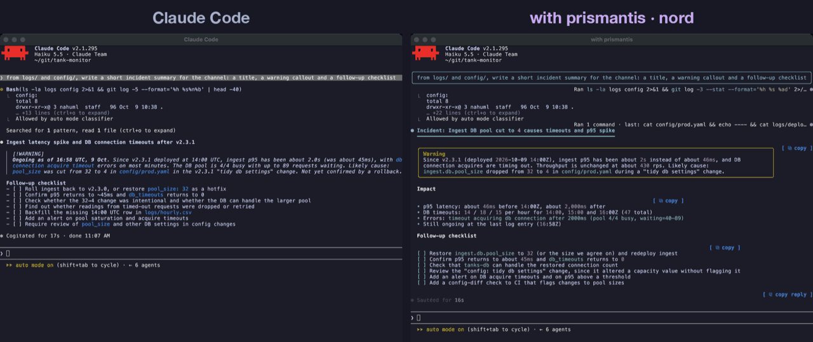

Terminals have one font size, so headings stand out through style and color. `headingStyle` picks the look:

| `banner` (default) | `bold` | `underline` | `uppercase` |
|---|---|---|---|
| a box around H1, a heavy rule under H2 | bold in the heading color | `bold` with H1 and H2 underlined | `bold` with H1 in capitals |
| 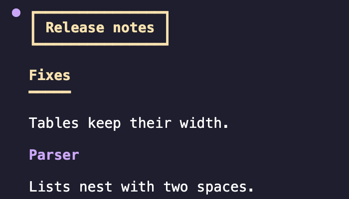 | 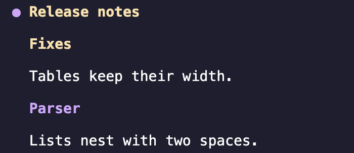 | 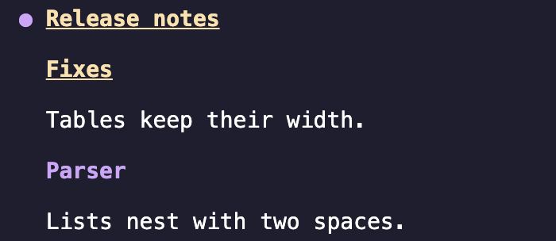 | 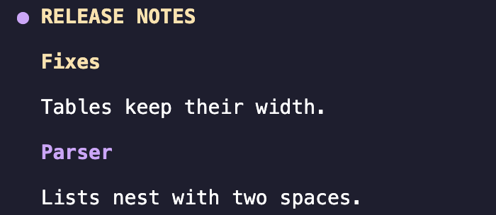 |

Lists keep their numbers and nest with `•` and `◦`. `listMarker: dash` draws `-` at every level instead, so a list you select with the mouse pastes as a markdown list into Slack, GitHub or a doc.

| `dots` | `dash` |
|---|---|
| 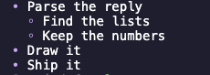 | 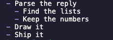 |

Quotes get an accent bar down every line and keep their paragraphs, lists, code, tables and nested quotes, and GitHub alerts (`> [!NOTE]`, `[!TIP]`, `[!IMPORTANT]`, `[!WARNING]`, `[!CAUTION]`) draw as colored boxes, in the terminal's blue, green, magenta, yellow and red unless `alertNoteColor`, `alertTipColor`, `alertImportantColor`, `alertWarningColor` or `alertCautionColor` sets one.

Task lists draw as `[ ]` and `[✓]`, with done items dimmed and struck through. `taskStyle` switches to `ticks` (`○` `✓`), `box` (`□` `✓`) or `progress`, which adds a done-count bar above each list.

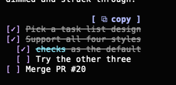

## Layout

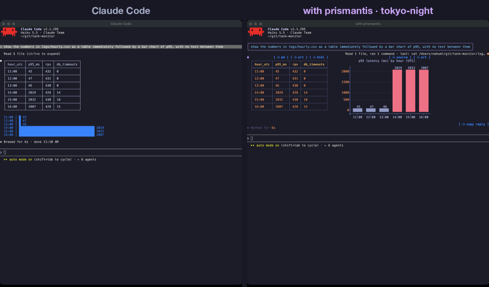

When tables, diagrams and figures follow each other, they share a row and wrap once the terminal runs out of width. A wide terminal shows a table, a flowchart and two charts side by side.

## Right to left

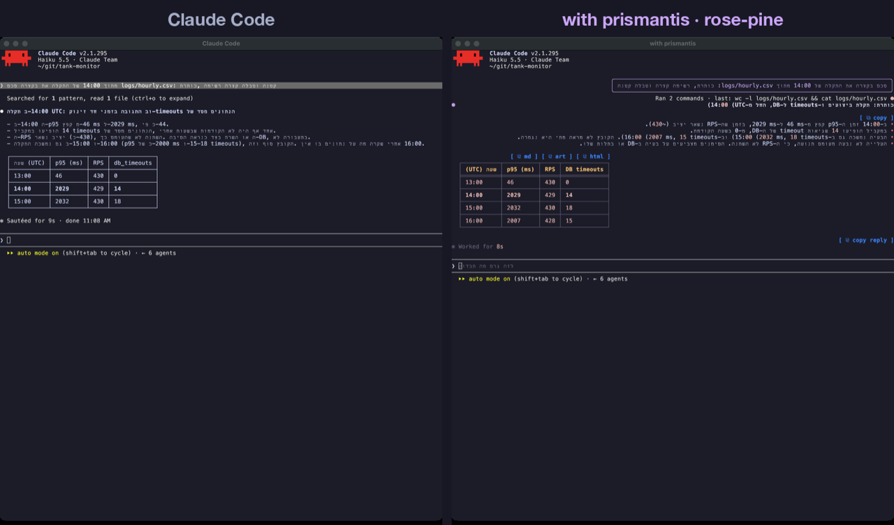

Hebrew and Arabic blocks are right aligned, with bullets, numbers and quote bars on the right and table columns mirrored. Code, numbers, paths and links stay left to right inside them. Terminals treat right-to-left letters differently, so prismantis detects yours and sends the letters the way it needs them. `/prismantis demo-rtl` shows every element, and the `rtl` option forces a terminal's handling or turns it off.
