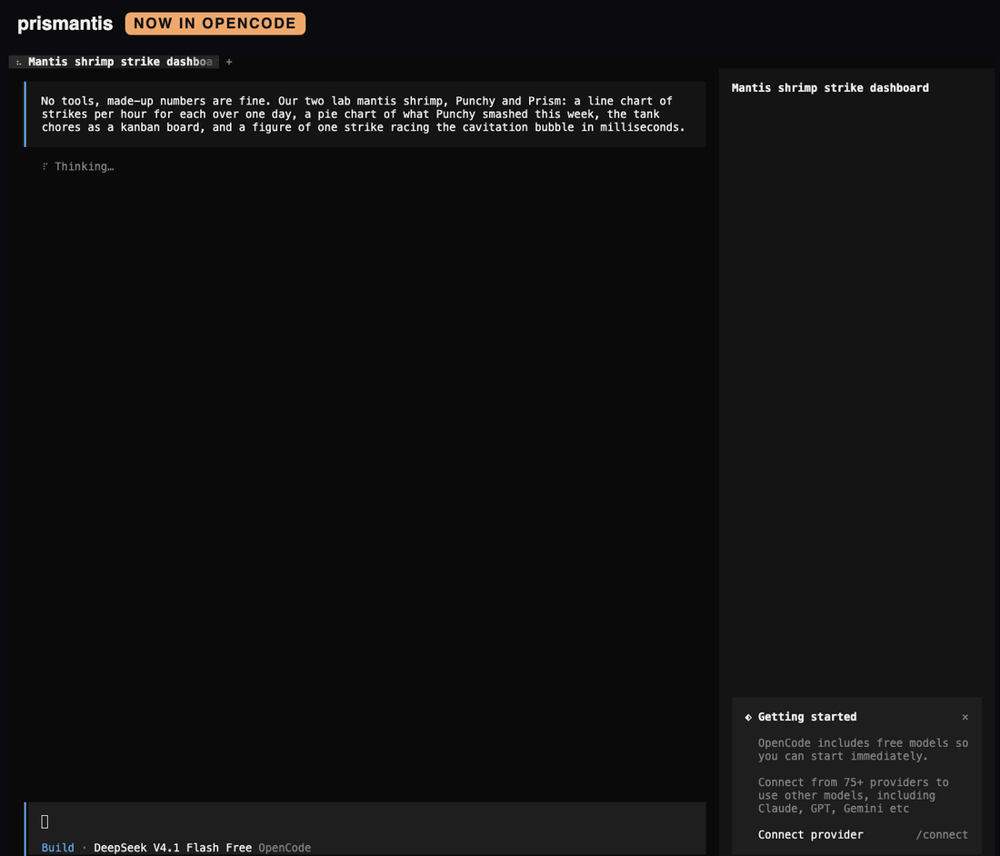
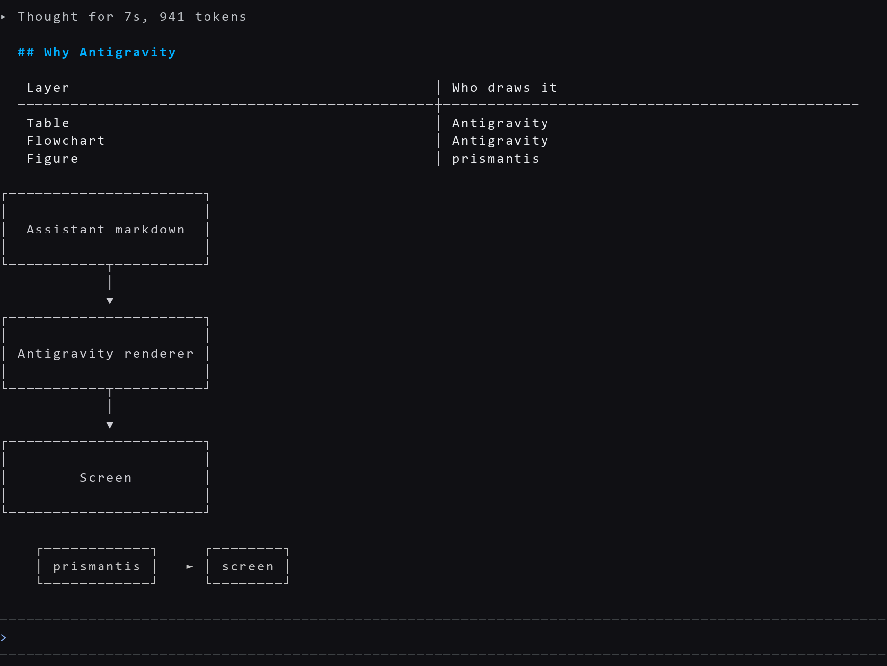

# Compatibility

prismantis is one Claude Code plugin and three ports generated from the same session note, figure hint and themes by `npm --prefix scripts run build:codex`. This page puts the four surfaces side by side; each port's README has its install steps and the issue it waits on for parity.

| | Claude Code | Codex | OpenCode | Antigravity |
|---|---|---|---|---|
| Who draws the reply | prismantis | Codex | OpenCode | Antigravity |
| Tables, headings, lists, links and fenced code | prismantis, in the theme colors | Codex, in the theme colors from 0.169.0 | OpenCode, in the theme colors | Antigravity, in its own colors |
| Mermaid | every kind prismantis draws | flowchart, sequenceDiagram, stateDiagram-v2, classDiagram and erDiagram, and any other kind as a figure | flowchart, sequenceDiagram, stateDiagram-v2, gantt, gitGraph and timeline, and prismantis draws xychart-beta, pie, quadrantChart, mindmap, journey, kanban, classDiagram and erDiagram from a ```chart block | flowchart and sequenceDiagram, and any other kind as a figure |
| Figures | drawn with their role colors | as the text picture they are | drawn with their role colors | as the text picture they are |
| Themes | every theme in `/prismantis setup` | one `.tmTheme` per theme | one theme per theme that has a code color | none, Antigravity keeps its own colors |
| `/prismantis demo` | yes | yes | yes | yes |
| Copy buttons, tool rows, diff cards, prompt styles, alert boxes, footnotes, right-to-left text | yes | not yet, waiting on Codex to let plugins draw its interface | not yet | not in Antigravity |

## What it looks like





## The same session note

Every surface sends the model the same note, built in `plugin/hooks/help.ts` and `plugin/hooks/figure.ts`. A short paragraph before it names the surface and says what that surface draws itself, so the note asks for a table, a diagram or a figure the same way everywhere, and a port never keeps its own copy to fall behind.

Codex sends the note through a session hook, Antigravity as its rules file and OpenCode as session context. The Claude Code plugin applies it through its own hint, so the four surfaces start from one text.

## Themes

The Claude Code themes come from `plugin/hooks/presets.ts`. Codex gets one syntax theme per preset, so code, inline code, table headers and mermaid take the colors. OpenCode gets one theme per preset that sets a code color, since its theme format reads the rest from the editor; `mono`, which has no colors, has no OpenCode theme. Antigravity has no theme format, so it keeps its own palette and the note leaves the `{role:text}` markup out.

## What this page checks

`npm --prefix scripts run compat:check`, also a step in CI, reads the folders the build writes and fails when:

- a version or an install pin disagrees across the Claude Code manifest, `.codex-plugin`, `.agents`, `opencode` and `antigravity`;
- a port points at a file it does not ship;
- an OpenCode theme has no Codex twin, or the two disagree on the code color;
- the theme count in a port's manifest, skill or README does not match its folder;
- the note Codex and Antigravity send differs from one another, names the wrong surface or loses the figure hint;
- the mermaid kinds a port names in its note, its demo, its README and this page disagree;
- a generated folder has lost the line that says it is generated.
