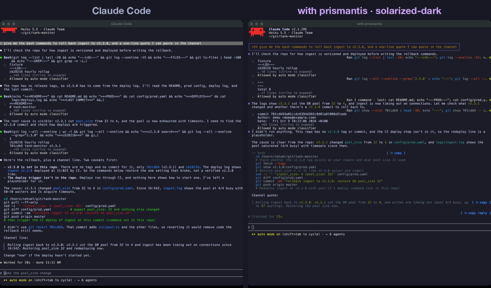
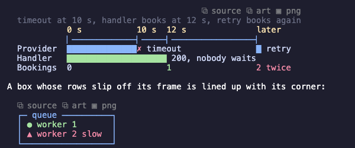
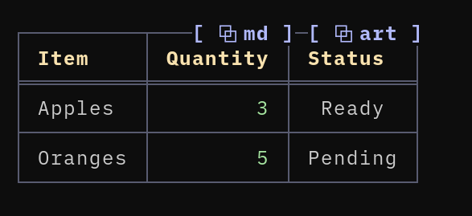

# Copy buttons

[← README](../README.md)

## Copy buttons



- **Tables:** `⧉ md` copies the original Markdown and `⧉ art` a boxed table that pastes well into Slack. `⧉ html` copies a formatted table (headers, alignment, inline formatting) plus a tab-separated plain-text copy.
- **Code, lists and quotes:** `[ ⧉ copy ]` on each. Code copies without its fences, lists as markdown, quotes without their `> ` markers. Set `textCopyButtons` to `false` to drop the buttons on lists, quotes and alerts and keep the rest.
- **Sections:** set `sectionCopyButtons` to `true` and each heading gets `[ ⧉ copy ]`, which copies its section as markdown, up to the next heading of the same or a higher level. Off by default.
- **Diagrams and figures:** `⧉ source` copies the mermaid or figure source, `⧉ art` the drawn art.
- **As an image:** `▣ png` on tables, diagrams and figures puts a PNG of the drawn art on the clipboard, monospace in the theme's text and background colors, ready to paste into Slack, docs or slides. It shows in a local macOS or Windows terminal and draws with the OS's own fonts (`osascript` on macOS, `powershell.exe` on Windows), so it needs nothing installed. If that fails, it copies the drawn text and the toast says why.
- **Whole replies:** replies with more than one block, or any Hebrew or Arabic, end with `⧉ copy reply`, which copies the reply as Claude wrote it. Selecting right-to-left text on screen copies letters in drawn order, not reading order.
- **Your prompts:** set `promptCopyButtons` to `true` and each of your prompts gets `⧉ copy` under it, which copies it as you typed it, pasted text included. Off by default.
- **No mouse:** `/prismantis copy` copies the last reply, `/prismantis copy code` its last code block.

`copyButtonStyle` picks how the buttons look and where they sit. `dim`, the default, draws them beside or above each block as bare `⧉ md ⧉ art` labels, dim until the pointer or the focus is on one, which lights it up. Older Claude Code versions draw them in plain white. `inline` draws the same buttons in the theme's accent color. `hover` puts a dim ⧉ beside each block's first row instead, at its left on a right-to-left block, and one in the reply's bottom-right corner for the whole reply. Pointing at a ⧉ draws its buttons over it, so they take no line and nothing moves when they show; the pointer on the block itself shows nothing. ctrl+x tab does not reach a hidden button, and the mobile app, which has no pointer, draws them inline.





`⧉ html` shows in a local macOS or Windows terminal, or a Linux graphical session. macOS and Windows need nothing extra. Linux needs [CopyQ](https://copyq.readthedocs.io/en/stable/installation.html) running (see its [Wayland caveats](https://copyq.readthedocs.io/en/stable/known-issues.html#on-linux-some-features-do-not-work-under-wayland)). On Ubuntu:

```bash
sudo apt install -y copyq && copyq --start-server && copyq config autostart true
```

Clicking works where the terminal passes clicks through, as fullscreen mode does. Terminals with copy-on-select, such as Warp, may grab the word "copy" instead.
