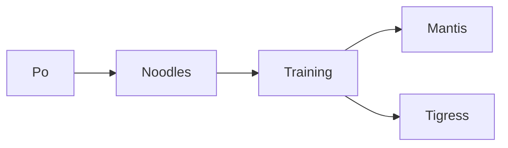
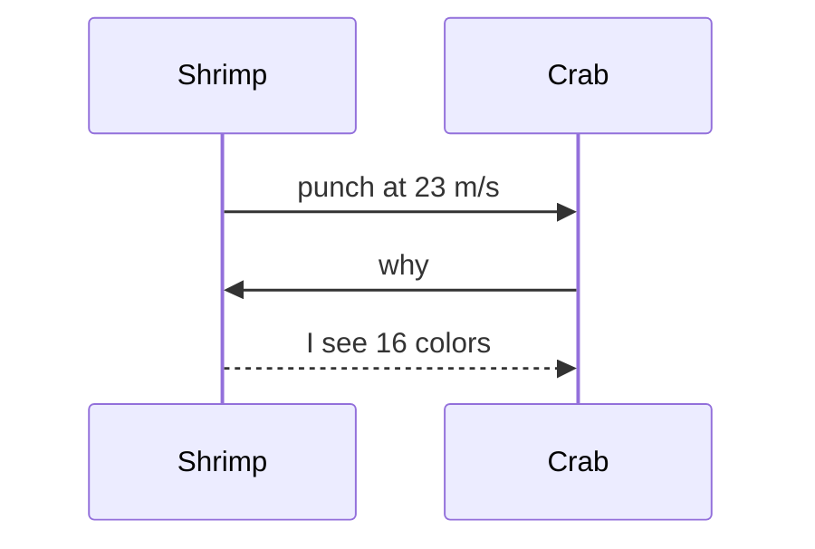
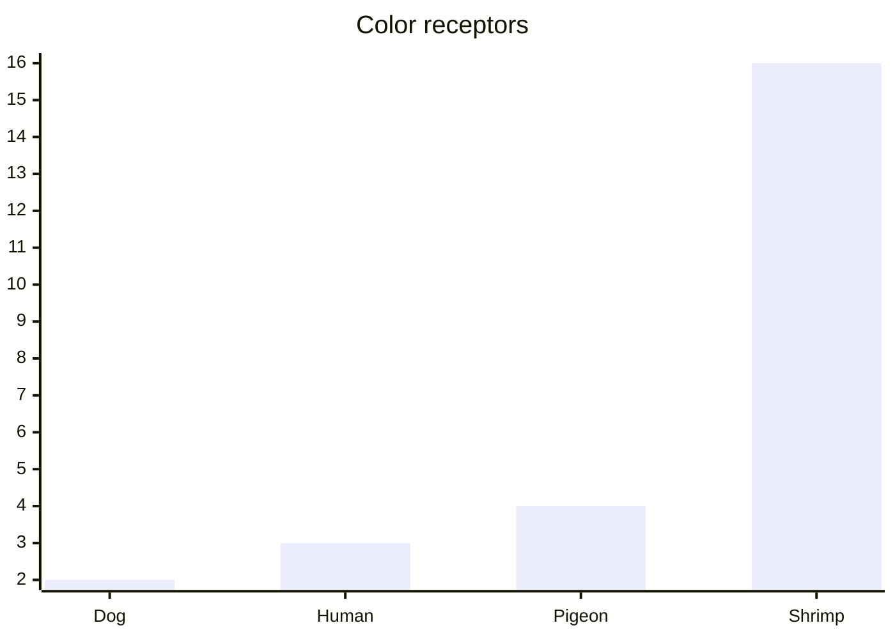
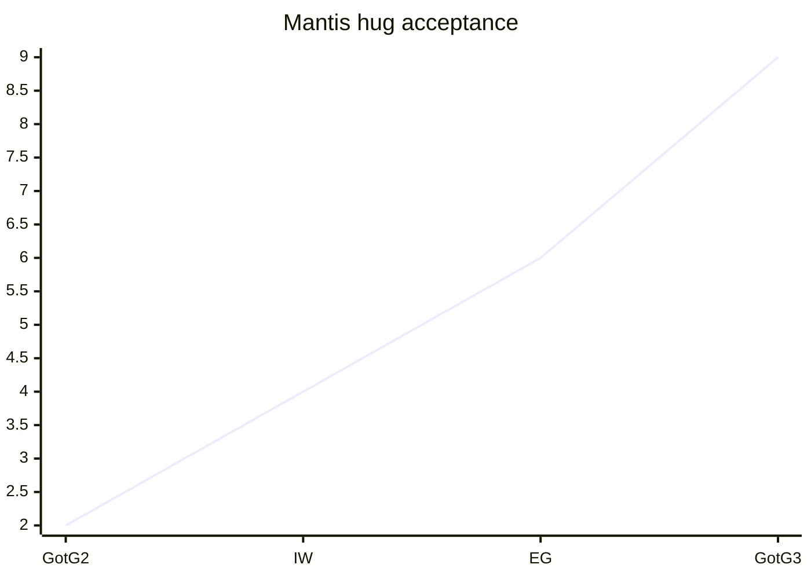
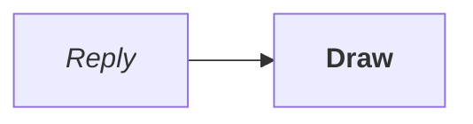
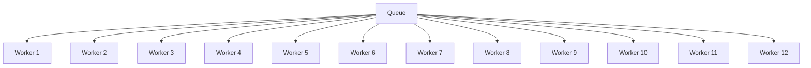

# prismantis

**Furious Five status:** Mantis cleared 3 dumplings in 6m 20s, kick power up 18% to 82 kicks/min. Notes in ~/jade-palace/training.md, scroll at https://github.com/NahumLitvin/prismantis

Type /kick to start; /srv/dojo/moves.md has the moves.

## Roster

| Mantis | Movie | Superpower | Size |
| :--- | :--- | :--- | ---: |
| Mantis | Kung Fu Panda | acupuncture kicks | 5cm |
| Mantis | Guardians of the Galaxy | empathy, awkward hugs | 168cm |
| mantis shrimp | real life | punches at 23 m/s | 10cm |

## Attachments

Long paths and checksums never split mid-word, so a column cannot shrink below them. When those minimum widths no longer fit the reply, `tableLayout` `auto` and `stacked` draw the table as one card per row, and `compact` keeps the columns at their longest word:

| Scroll | Checksum |
|:-------|:---------|
| ~/jade-palace/noodle-scrolls/scrolls/scroll-07-training-notes.md | 9f86d081884c7d659a2feaa0c55ad015a3bf4f1b2b0b822cd15d6c15b0f00a08 |
| /srv/dojo/moves.md | 2c26b46b68ffc68ff99b453c1d30413413422d706483bfa0f98a5e886266e7ae |

## Status matrix

When a table has a status column — the one whose cells are things like ✓, passed, failed or pending — `statusMatrix` `color` draws those cells in theme colors: green for a pass, red for a failure, amber for a warning, gray for a wait. `summary` adds a count line under the table and `group` reorders rows by status with a heavy rule where the status changes. The default `off` keeps tables as written:

| Suite | Cases | Result |
|:------|------:|:-------|
| Unit | 412 | ✓ |
| Propagation | 88 | failed |
| Smoke | 24 | pending |
| Regression | 130 | ✓ |

## Test report

When a table draws a run — a status column of things like ✓ or failed next to durations like 120 ms — `testMatrix` `report` adds a line under the table with how much of the run passed, a count of every other kind of result and the time all of it took. The line reuses the status colors and replaces the `statusMatrix` count line when both draw. The default `off` keeps tables as written:

| Check | Time | Result |
|:------|-----:|:-------|
| parse | 120 ms | ✓ |
| draw | 4 s | ✓ |
| scan | 130 ms | failed |
| typeset | 2.6 s | pending |

## Benchmarks

When a table compares benchmarks — a column of changes like -10% or +3% beside two columns of runs — `benchTable` draws each change in theme colors, green for an improvement and red for a regression; timings read as lower is better unless a header speaks of req/s, throughput or a score. `trend` also draws a sparkline of the runs under the table, each step colored by whether it improved. The default `off` keeps tables as written:

| Benchmark | Before | After | Change |
|:----------|-------:|------:|:-------|
| parse | 12.4 ms | 11.1 ms | -10% |
| layout | 19.6 ms | 22.4 ms | +14% |
| paint | 2.1 ms | 0.8 ms | -62% |

## Schema

When a table describes a database schema — a column of fields beside a column of types — `schemaTable` draws the type cells by their family: text types like varchar in the string color, numeric types like int in the number color, booleans in the emphasis color, time types like timestamp in the link color. `keys` draws the constraint cells — PK in the accent color, FK in the link color, unique and index cells in gray — and `full` does both. The default `off` keeps tables as written:

| Column | Type | Key | Default |
|:-------|:-----|:----|:--------|
| id | uuid | PK | |
| email | varchar(255) | UNIQUE | |
| org_id | bigint | FK → orgs.id | |
| created_at | timestamp | | now() |

## Key-value

When a table lists configuration — a column of options beside columns of values, sources and defaults — `kvTable` draws the source cells by where it says the value comes from: env in the link color, config in the string color, default in gray. `overrides` draws the value cell in the accent color when the row's value differs from its default, and `full` does both. The default `off` keeps tables as written:

| Option | Value | Source | Default |
|:-------|:------|:-------|:--------|
| retries | 5 | env | 3 |
| format | json | config | json |
| timeout | 30s | default | 30s |
| token | abc123 | env | unset |

1. Wake up, stretch all 6 legs
2. Pray to the noodle gods
   - extra dumplings
   - no tofu













```figure
{dim:timeout at 10 s, handler books at 12 s, retry books again}
          {note:0 s}           {note:10 s}  {note:12 s}              {note:later}
          {accent:▏─────────────▏─────▏─────────────────▏}
Provider  {accent:██████████████}{warn:✗} timeout               {accent:█} retry
Handler   {ok:████████████████████} 200, nobody waits
Bookings  0                   {ok:1}                 {warn:2 twice}
```

```ts
const master = "Shifu" // wise, short
export function train(student: string, dumplings = 3) {
  return `${student} ate ${dumplings} dumplings`
}
```

```bash
kungfu train --student "Po" --master shifu --dumplings 3 && echo "skadoosh"
```

> [!TIP]
> If `inner peace` returns 404, try `snacks` first.

> Mantis wisdom: small bug, big kick.
>
> - stretch all **6** legs
> - then `kick`

<tldr>
Kick at ~/dojo/mat, then rest.
</tldr>

## עברית

**שלום חברים**, התוסף מצייר גם עברית עם מונחים באנגלית כמו `kubectl`, מספרים כמו 99.9% ו-250ms, וגם [קישור](https://github.com/NahumLitvin/prismantis).

- פרוסים ב-us-east ו-eu-west (שני אזורים)
- מחליפים ערכת נושא עם `/prismantis theme nord`

1. מתעוררים ומותחים את כל 6 הרגליים
2. מתפללים לאלי הנודלס

> עברית נקראת מימין לשמאל, גם בטרמינל בלי תמיכה בכיווניות

| לוחם | סרט | כוח על |
| :--- | :--- | :--- |
| מנטיס | קונג פו פנדה | בעיטות דיקור |
| שרימפ | מציאות | אגרוף ב-23 m/s |

```bash
ls -la # רשימת הקבצים
```
