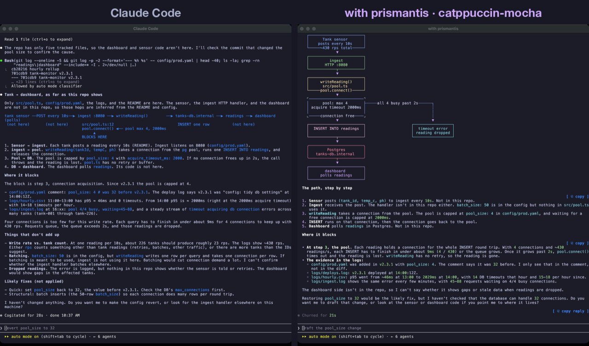
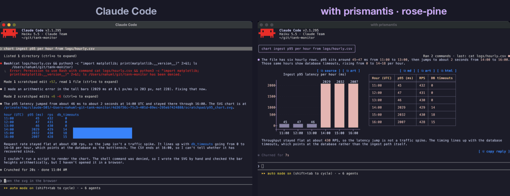
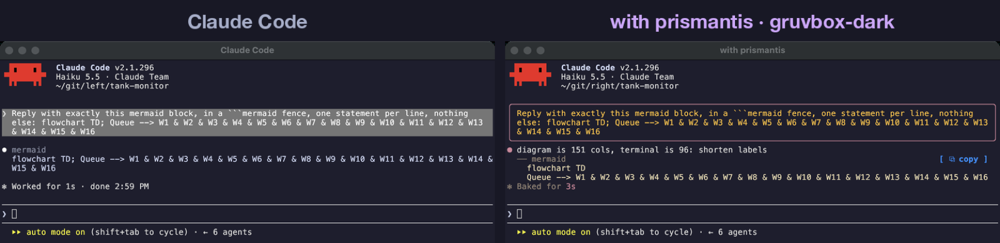
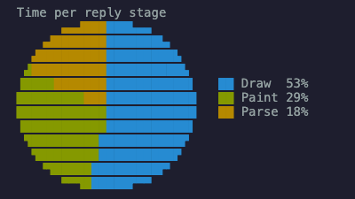
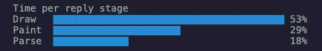
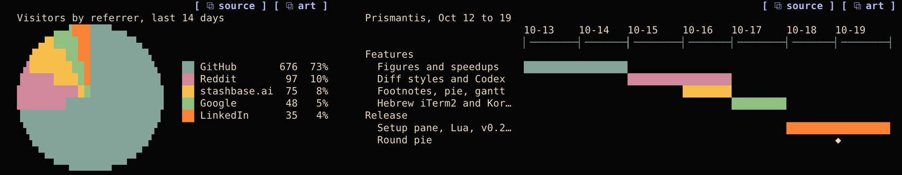
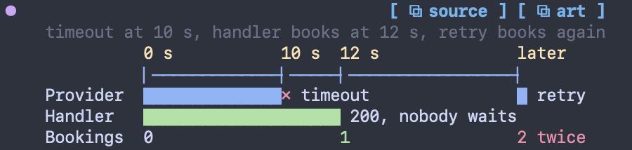
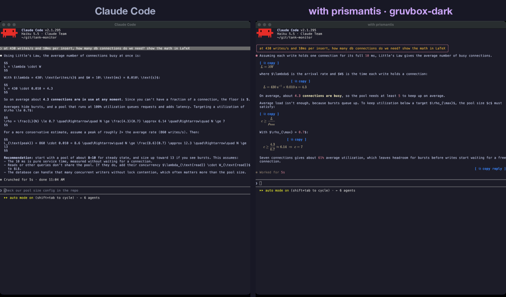

# Diagrams, charts, figures and math

[← README](../README.md)

## Diagrams and charts







Code blocks tagged `mermaid` draw as colored text art:

- flowcharts (`graph LR`, `graph TD`, decisions), sequence, state, class and ER diagrams
- bar and line charts with `xychart-beta`, sized to the terminal width
- `pie` charts as a circle with a colored legend, largest slice first, drawn as a smooth picture in kitty and Ghostty, and `gantt` schedules as bars on a shared date or time axis, starting on a half cell and ending on an eighth so close durations draw apart
- `quadrantChart` grids with the quadrant names in their corners and numbered points listed under the grid; points that land on one cell are moved apart within their own quadrant
- `mindmap` trees drawn from the root to the right, each branch in its own color, switching to an indented outline when the map is wider than the terminal
- `journey` maps with the sections over their tasks and a mood line from score 1 to 5, green dots for good steps and red for bad ones; with too many tasks for the width each task becomes a row with its score drawn as a bar
- `kanban` boards with the columns side by side and a card count in each header, each card a rounded box in its column's color holding the wrapped task and its assigned, ticket and priority metadata (high priorities in red); columns stack when the terminal is too narrow
- `gitGraph` histories drawn top to bottom with one colored lane per branch, forks and merges joined by box lines, commit ids and `[tags]` beside each row, highlight and reverse commits marked, and cherry-picks labeled
- each box and participant gets its own theme color, the same at both ends of a sequence diagram
- bars in a multi-series chart get their own colors; a single-series chart prints each value above its bar and colors the tallest one
- gridlines stay dim, axis numbers use the number color

`pieStyle` picks how a pie draws. `round` draws the circle as a smooth picture in kitty and Ghostty, outside tmux, and as text elsewhere; `⧉ art` still copies the text circle. It falls back to bars in ascii mode, with more slices than the theme has distinct colors (mono always) or in a narrow terminal:

| `round` (default) | `bars` |
|---|---|
| a circle, each slice in its own color, with a legend | one bar per slice, largest first, with its share |
|  |  |



Diagrams too wide for the window, or over 80 lines, stay as code. `mermaidAscii` swaps box-drawing characters for `+ - |`.

## Figures

Some things read better as a picture than as a diagram: a timeout racing a retry, the layout of a screen, a system before and after a change. Code blocks tagged `figure` draw line by line as written, in the theme's colors:



<details>
<summary>The markdown Claude wrote for it</summary>

````markdown
```figure
{dim:timeout at 10 s, handler books at 12 s, retry books again}
          {note:0 s}           {note:10 s}  {note:12 s}              {note:later}
          {accent:▏─────────────▏─────▏─────────────────▏}
Provider  {accent:██████████████}{warn:✗} timeout               {accent:█} retry
Handler   {ok:████████████████████} 200, nobody waits
Bookings  0                   {ok:1}                 {warn:2 twice}
```
````

</details>

- `{role:text}` colors a run: `accent` for frames, lines and arrows (diagram color), `warn` for the break or the risk, `ok` for what is healthy or done, `note` for time and effort, `dim` for side notes (comment color), `strong` for the one thing that matters (strong color); the rest takes the diagram text color. `warn`, `ok` and `note` take the theme's reddest, greenest and most amber accent color, each a different one and none the diagram color, so a risk never looks like a frame line in any theme; hex and `rgb()` colors you set take part in that pick, and a role whose own slot (flag, string or heading color) you set to a color name or `ansi256()` keeps that color
- ▶ and ◀ draw as ► and ◄, as in diagrams, so no glyph turns into an emoji; in `mono`, `warn` draws bold
- a figure stays a code block while it streams (so a reply that opens with a figure shows its markup until the block closes), when it has more than 80 lines, when a line is wider than the window or than 100 columns, and when a line would not draw as written: a glyph that may draw as an emoji or takes two columns, a tab, a control character, a direction mark or another character that draws no column (a zero-width space, a soft hyphen), or role markup in the wrong case, misspelled, nested or left open; once the block is closed, a dim line above it says why, such as `figure line 4: "⚠" may draw as an emoji, use a text glyph`
- frames are not checked: a box that does not close or a side, corner or divider out of its column draws as written, as Claude typed it, so a frame that is slightly off still draws
- `⧉ source` copies the block as Claude wrote it, `⧉ art` the drawn text
- figures draw whether `mermaid` is on or off; only the [diagram hints](model-hints.md#diagram-hints) note follows `mermaid`
- Claude learns about figures from the [diagram hints](model-hints.md#diagram-hints) note: prefer a figure over mermaid when position carries meaning (durations racing on a time axis, a screen layout, phases, before and after); when you ask to explain, compare or plan something and pictures would make it easier to grasp, build the reply around them, with the core on the first screen; the prose does not retell the picture; then the roles, the width and the glyphs that draw cleanly; plain flows and charts stay mermaid

## LaTeX math



Display math, `$$…$$` on lines of its own or a ` ```math ` block, draws as a typeset image in the theme's diagram text color, one formula per line. With copy buttons on, its `⧉ copy` button copies the formula's LaTeX, since selecting an image copies blank cells. It needs [RaTeX](https://github.com/erweixin/RaTeX)'s PNG renderer, a single binary that typesets KaTeX syntax in a few milliseconds without TeX, a browser or Node:

```bash
gh release download -R erweixin/RaTeX -p 'ratex-cli-*-aarch64-apple-darwin.tar.gz'
tar -xzf ratex-cli-*.tar.gz
mkdir -p ~/.local/bin
install ratex-cli-*/render ~/.local/bin/ratex-render
```

Pick the archive for your platform (`x86_64-apple-darwin`, `x86_64-unknown-linux-musl`, ...). Any directory on your `PATH` works, but the file must be named `ratex-render`.

LaTeX is off until you set `latex` to `true`. Then prismantis runs `ratex-render` once in kitty and Ghostty, outside tmux, or wherever `CLAUDE_CODE_FORCE_TERMINAL_IMAGES` makes Claude Code draw images, such as a background session viewed in one of them, and keeps LaTeX on only if that test formula comes back. If a later run fails, formulas already drawn stay and new ones stay text until you `/reload`. A reply shown before the test finishes draws its formulas as text, then redraws them as images. Anywhere else, without the renderer, or with `latex` off, formulas draw as text in a `math` code block. So does a formula the renderer rejects, or one too wide for the terminal even at one row. While LaTeX is on, the [diagram hints](model-hints.md#diagram-hints) note also tells Claude that `$$` math renders. Inline `$…$` draws as italic text without its dollar signs, with common commands such as `\rho`, `\cdot` and `\le` shown as symbols; amounts like `$5` stay as written.

Formula text matches the reply text. A terminal image fills whole rows, so a formula that falls between two row counts is rendered again with more padding rather than stretched.
