# Tables

[← README](../README.md)

## Tables

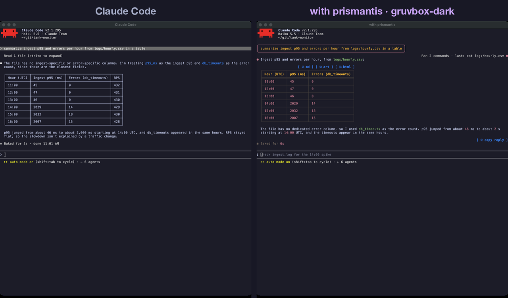

Header cells take the `tableHeader` color, and the default `box` style puts a double line under the header. `tableStyle` picks `box` (the default, every cell boxed), `rules`, `grid` or `minimal`. `:---:` and `---:` alignment is honored, numbers in cells get the number color, and columns shrink to fit the terminal. `tableLayout` picks `classic` (the default: today's look, columns share the width and shrink to the terminal), `auto` (the same, and a table that cannot even fit its longest words stacks each row as a card of label and value pairs), `compact` (every column sits at its longest word, so long cells wrap inside a narrow table) or `stacked` (always cards). In the desktop app, which sets text in a proportional font, the lines of every style are drawn as thin colored boxes instead of characters, and columns take a share of the reply's width so long cells wrap inside them; the layouts keep that there. `statusMatrix` reads a table's status column — the one whose cells are things like ✓, passed, failed or pending — and draws those cells in theme colors, green for a pass, red for a failure, amber for a warning and gray for a wait; `summary` adds a count line under the table, like `✓ 2 · ✗ 1 · ● 1`, and `group` reorders rows by status and draws a heavy rule where the status changes. The default `off` keeps tables as written. `testMatrix` reads a table that draws a run — a status column of things like ✓ or failed next to durations like 120 ms — and `report` adds a line under the table with how much of the run passed, a count of every other kind of result and the time all of it took, in the theme's status colors; the report replaces the `statusMatrix` count line when both draw. The default `off` keeps that line away. `benchTable` reads a table that compares benchmarks — a column of changes like -10% or +3% beside two columns of runs — and draws the changes in the theme's colors, green for an improvement and red for a regression; timings read as lower is better unless a header speaks of req/s, throughput or a score. `trend` also draws a sparkline of the runs under the table, each step colored by whether it improved. The default `off` keeps tables as written. `schemaTable` reads a table that describes a database schema — a column of fields beside a column of types — and draws the type cells in theme colors by their family, text types like varchar in the string color, numeric types like int in the number color, booleans in the emphasis color, time types like timestamp in the link color; `keys` draws the constraint cells, PK in the accent color, FK in the link color, unique and index cells in gray, and `full` does both. The default `off` keeps tables as written. `compareTable` reads a table that compares options — a column of scores beside a column of ranks — and draws the rank cells as a medal, 1 in the accent color and 2 and 3 in the link color; `pick` draws the score cell of the top score in the improvement green, the hue `benchTable` gives an improvement, and bolds it so it stands out even in a theme where that green is also the number color, and `full` does both. The default `off` keeps tables as written. `apiTable` reads a table that documents an API — a method column whose cells are HTTP verbs — and draws the method cells by what the verb does, reads like GET and HEAD in the link color, writes like POST, PUT and PATCH in the string color, DELETE in the removed color, other verbs in gray; `auth` draws the scheme cells of an auth column, Bearer, OAuth, API key, JWT and Basic in the accent color, and `full` does both. The default `off` keeps tables as written. `kvTable` reads a table that lists configuration — a column of options beside columns of values, sources and defaults — and draws the source cells by where they say the value comes from, env and environment in the link color, config, settings, flag and cli in the string color, default, unset and none in gray; `overrides` draws the value cell of a row whose value differs from its default in the accent color, and `full` does both. The default `off` keeps tables as written. `groupTable` reads a table that groups its rows — the first column whose cells repeat in runs, like a column of services or teams — and draws each group once: `merge` labels the group in the accent color and blanks the repeats under it, `count` also adds the group's size to the label, like `api (2)`, and `full` also draws a heavy rule where one group ends and the next begins. A column of numbers never groups, and a table already grouped by `statusMatrix` keeps its status grouping. The default `off` keeps tables as written. `heatTable` reads a table of numbers — each column carrying the same unit, like a column of requests beside a column of latencies — and draws each number by where it sits between its column's lowest and highest: `color` puts the lowest in the table's text color, the next in the number color, the next in the accent color and the highest in the accent color and bold, and `bars` also adds one block glyph after each number, `▁`, `▄`, `▆` or `█` by the same four steps, so size reads without color. A column whose values are all equal stays as written, and a cell another table look already colored keeps that color. The default `off` keeps tables as written. `treeTable` reads a table that nests its rows — a column of areas beside a column of services and their tasks — and draws each run of a repeated first column once, in the accent color, with the rows under it as branches: `branch` prefixes each row with `├─` or `└─`, the last row of the run taking the corner, and when the next column repeats too it merges the same way and carries one `│` per continuing parent before its branch, so three levels draw as a tree; `full` also draws a heavy rule where one top-level group ends and the next begins. A column of numbers never nests, `treeTable` wins over `groupTable` on the same table, and stacked tables stay as they are. The default `off` keeps tables as written. `pivotTable` reads a table of metrics and periods — a column of names beside a header of quarters, at least 60% of its cells numbers and fewer rows than quarters — and `transpose` draws it with rows and columns swapped, so the periods read down the side and each metric has a column of its own, which fits a narrow terminal better than a long row. It adds no totals and no averages, so a table copied as markdown keeps exactly what was written. The default `off` keeps tables as written.

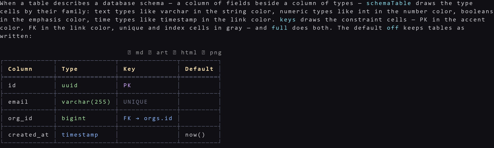

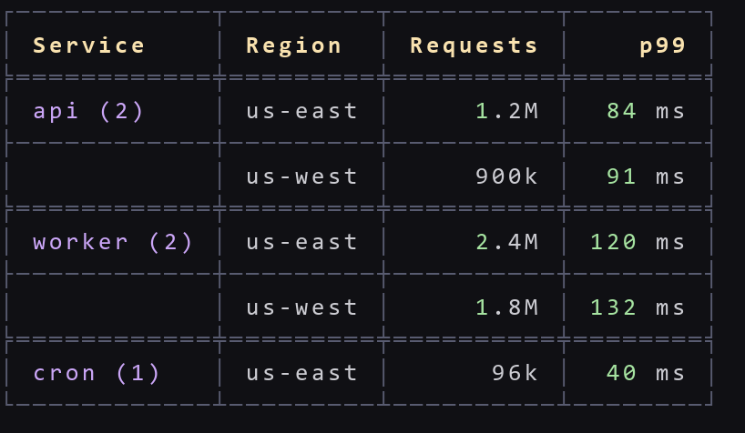

| `merge` | `count` | `full` |
|---|---|---|
| each group labeled once | the label plus the group's size | both, with a heavy rule between groups |
| 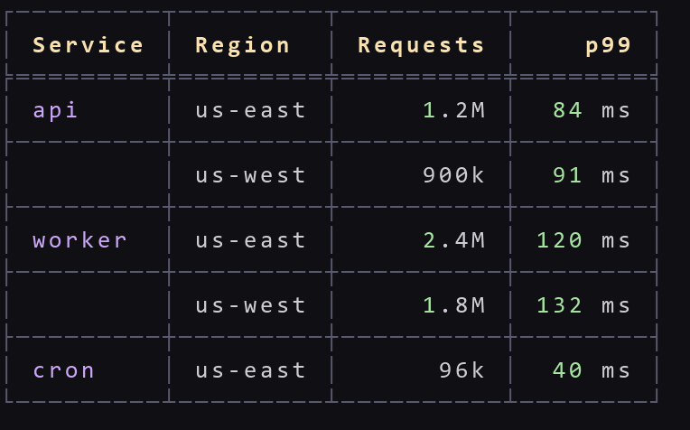 | 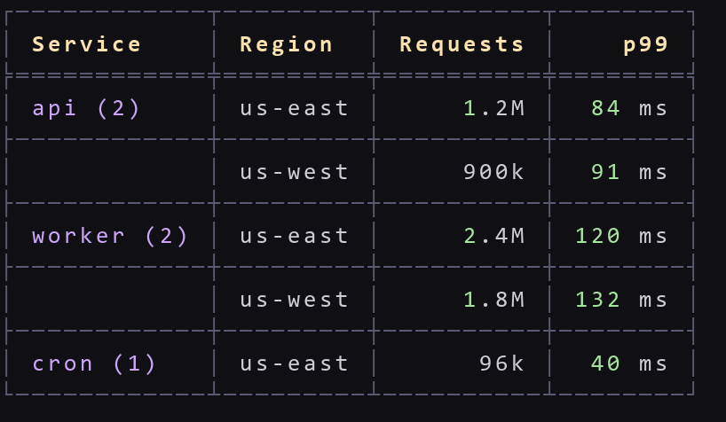 |  |

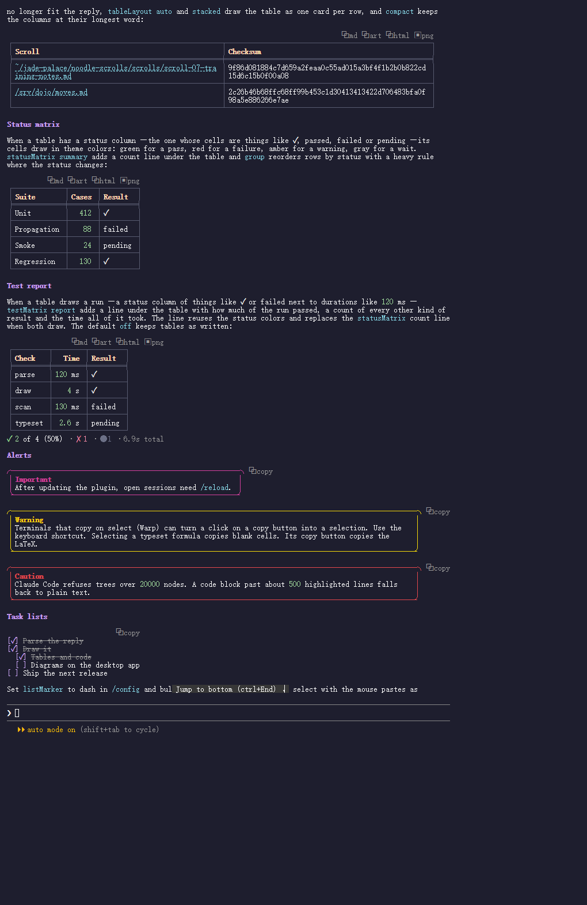

| `color` | `summary` | `group` |
|---|---|---|
| status cells in theme colors | a count line under the table | rows reordered by status, a heavy rule between |
| 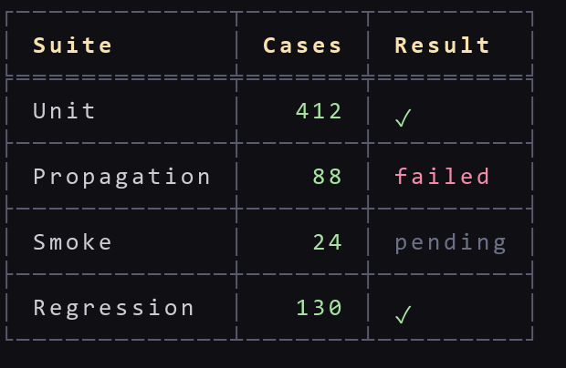 | 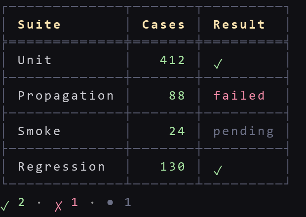 | 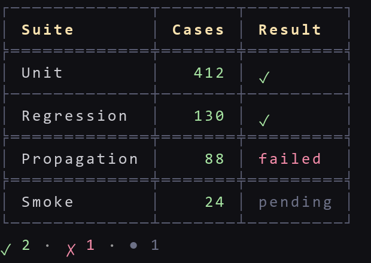 |

| `classic` (default), 50 columns | `auto`, 50 columns | `compact`, 72 columns | `stacked`, 72 columns |
|---|---|---|---|
| columns share the width, a long path splits | the path cannot fit, so rows stack as cards | columns at their longest word | cards even when the table fits |
| 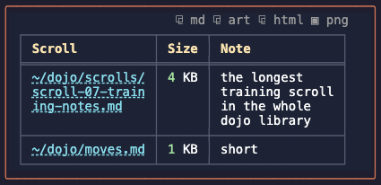 | 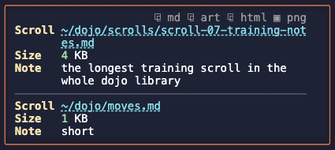 | 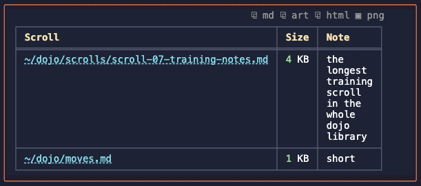 | 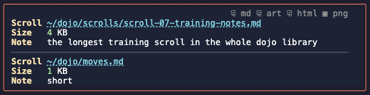 |

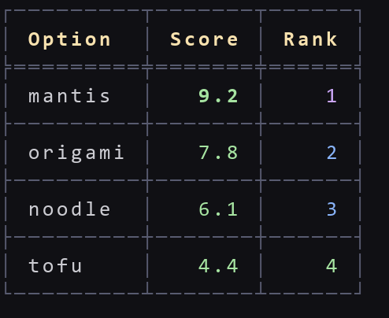

| `rank` | `pick` | `full` |
|---|---|---|
| ranks colored as a medal | the top score in the improvement green, bold | both |
| 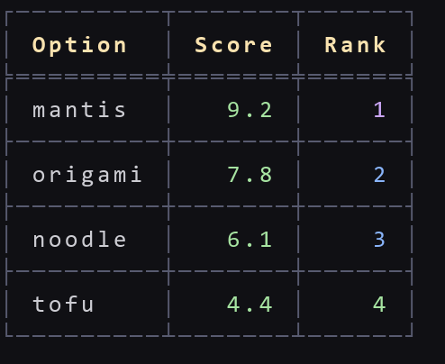 | 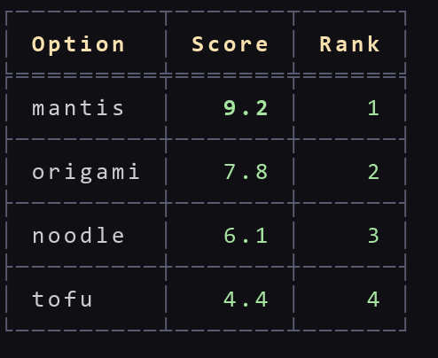 |  |

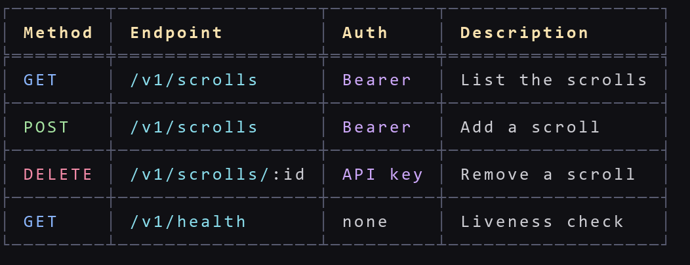

| `verbs` | `auth` | `full` |
|---|---|---|
| method cells by verb | scheme cells in the accent color | both |
| 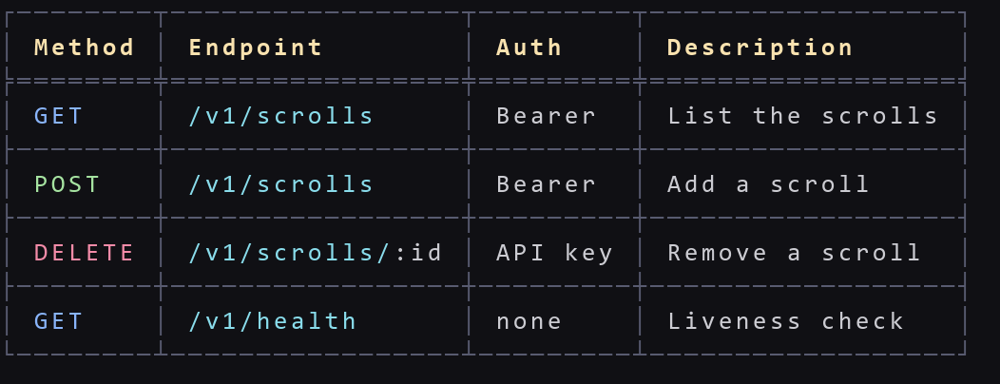 | 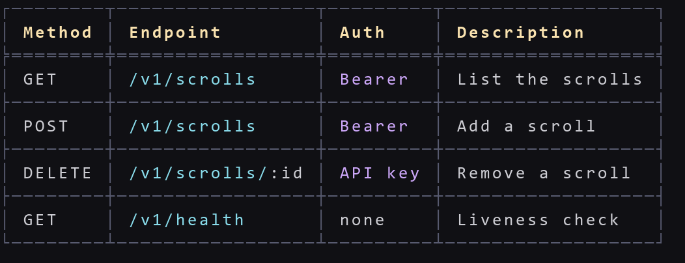 |  |

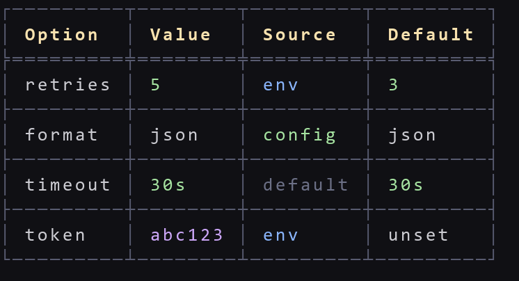

| `sources` | `overrides` | `full` |
|---|---|---|
| source cells by origin | moved values in the accent color | both |
| 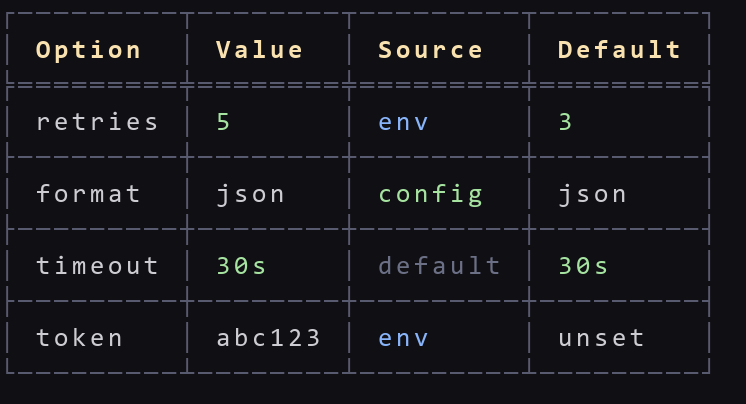 | 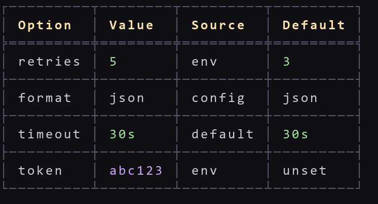 |  |

| `color` | `bars` |
|---|---|
| each number colored by its place in its column | the same, with a block glyph by the four steps |
| 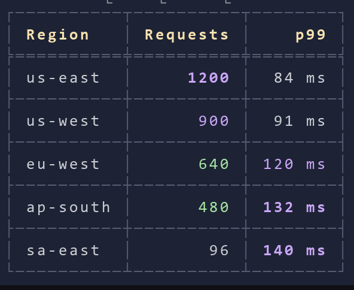 | 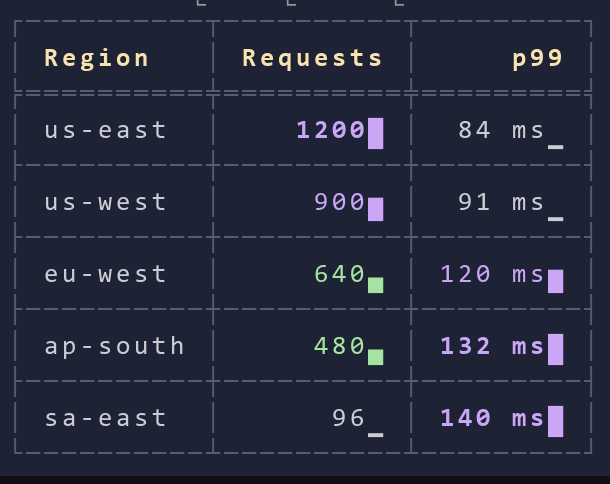 |

| `branch` | `full` |
|---|---|
| runs of a column labeled once, rows as branches | both, with a heavy rule between top-level groups |
| 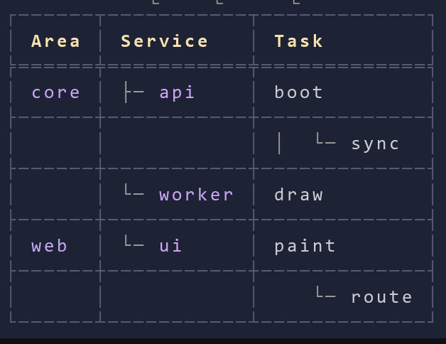 |  |

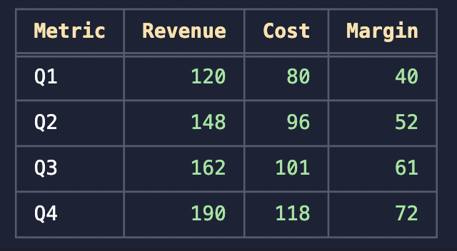
