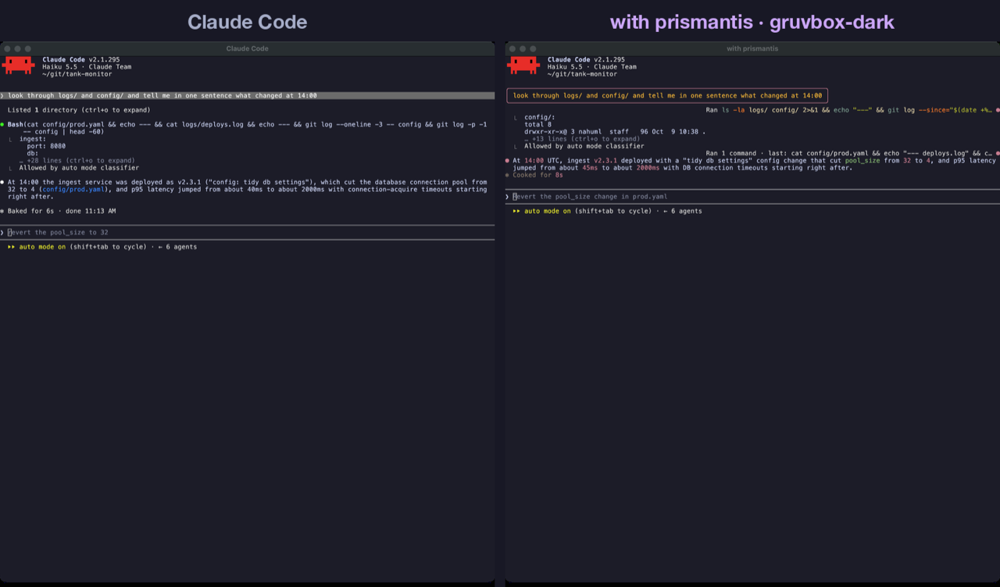
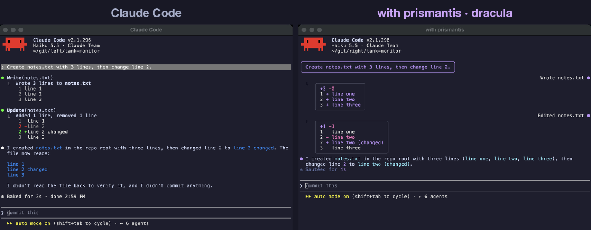
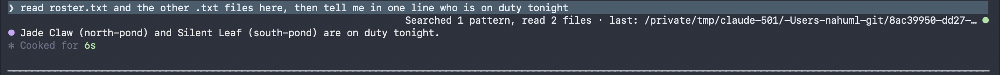
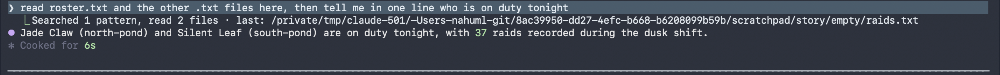
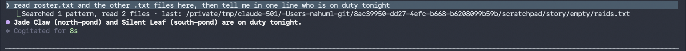
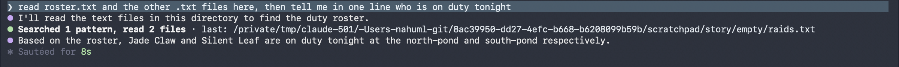
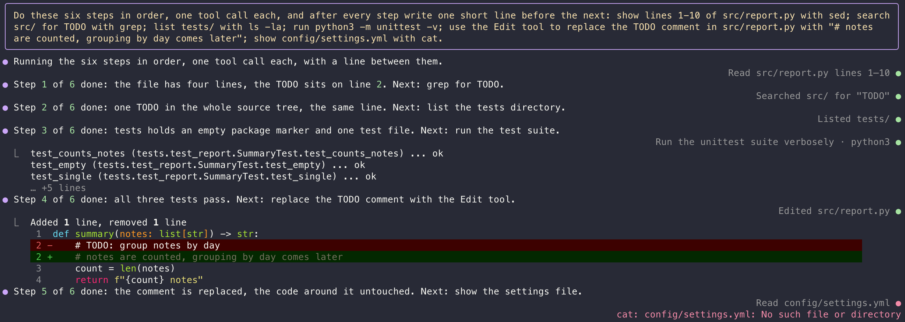

# Tool output: quiet and rows

`toolOutput` picks how much of a call shows. The default, `full`, is what Claude Code shows. `quiet`, set in `/config` or as `"toolOutput": "quiet"` in `settings.json`, shows what Claude did, not what it read. `rows` is `quiet` with nothing under a call that worked. Needs `toolRows` on.

## quiet

- Read, Grep, Glob, web fetches and shell commands made only of read-only programs (`cat`, `grep`, `rg`, `ls`, `find`, `git log`, `gh pr view`, …) draw their row and nothing under it, and the row says it in plain words: `Read src/report.py lines 1–10`, `Searched src/ for "TODO"`, `Listed tests`.
- A shell call with no such form shows the description Claude gave it and the programs it ran: `Run the unit tests · python3`.
- Other shell commands show their first 3 lines and a count, without the approval line, also when Claude Code folded the call into a collapsed group.
- Edits keep their diff card, and a shell command that changed files keeps one card per file under its first lines. New, deleted and renamed files keep their preview, `Deleted` line and `Renamed` line.
- A failed call shows the last real line of its error instead of `Exit code 1`; a refused call (a permission rule, the auto mode classifier) shows its full reason.

## rows

`rows`, set as `"toolOutput": "rows"`, draws everything as `quiet` does, with these differences:

- A shell call that worked draws its row and nothing under it, read-only or not: `npm test` shows no first lines and no count.
- A shell command that changed files keeps one diff card per file, without its first lines above them.
- Any other call that worked, an MCP tool or an agent, draws only its row too.

These stay as in `quiet`:

- Edits keep their diff card.
- A failed call shows the last real line of its error, and a refused call its full reason.
- An expanded call, and the ctrl+o transcript, show the whole result.
- Background, image and interrupted shell results are left to Claude Code.

## What counts as read-only

A command counts as read-only only when every part of it is, after a quote-aware split on `;`, `&&`, `||`, `|`, `&` and newlines, with no redirect into a file, no `$(…)`, no heredoc and no write flags (`sed -i`, `find -delete`, …). In doubt, the result shows.

## Tool rows

Each tool call draws as one line: a verb and its target, `Ran` with a colored shell command, `Read` and `Edited` with the path, which opens the file on click like a path in a reply (see [Text](appearance.md#text)). A status dot shows done, running or failed, and output still draws below. Edits draw as a diff card in the theme's colors, and so do files a shell command changed (`sed -i`, a script), one card per file headed by its path. A file Write creates is no diff, as in Claude Code's own preview: `Created <path> (N lines)` heads its first 10 lines as numbered code in the theme's colors, and a click anywhere on it, title or lines, or on `+N more lines` opens the rest; `show less` or another click folds it again. A diff card or a new file's preview with lines folded away opens the same way. A file an Edit or a shell command creates shows its first 10 lines as added diff lines under the same header. A file a shell command deletes is one `Deleted <path> (N lines)` line, and a click on it opens its removed lines. A file moved unchanged is one `Renamed <old> → <new>` line. Before Claude Code 2.1.295, files Write creates keep Claude Code's own preview, a new file's lines open with a `+N more lines` button and a deleted file's with a `show N lines` button. In the desktop app a click on the code lines does nothing; the `+N more lines` button does it. In diff cards added and unchanged lines are highlighted in the file's language, removed lines stay plain as in Claude Code, and when a line is edited rather than rewritten, the words that changed get a deeper tint. `diffStyle` picks the look: `card` (default) frames the lines in a rounded box, `full` drops the box and tints each changed line across the width, `marks` drops the tint and colors only the `+` and `−` marks, and `bar` puts a colored `▌` before each changed line.

| `card` (default) | `full` | `marks` | `bar` |
|---|---|---|---|
| rounded box, tinted lines | no box, lines tinted across the width | no tint, colored `+` and `−` | no tint, a colored `▌` before each changed line |
|  |  |  |  |

Collapsed groups draw one line too: `Ran 3 commands, read 2 files · last: npm test`, with `· N failed` in the flag color when any call failed. Expand a group (ctrl+o or `--verbose`): shell calls keep their colored command with the output boxed below, and other calls use Claude Code's own rows. ctrl+o on a reply shows the original text.

`toolStyle` keeps tool rows apart from what Claude says:

| `chat` (default) | `tree-dim` | `tree-bold` | `classic` |
|---|---|---|---|
| dimmed on the right, capped at 60% of the width | tucked under the sentence with `⎿`, dimmed | `tree-dim` with one-line sentences in bold | bold verb and status dot, full brightness |
|  |  |  |  |

`toolOutput: quiet` shows what Claude did, not what it read: reads, searches and read-only shell commands draw one plain row like `Read src/report.py lines 1–10` and nothing under it. Edits keep their diff and failures show their real error; the full rules are in [docs/tool-output.md](tool-output.md). `toolOutput: rows` goes further: a call that worked draws only its row, so `npm test` shows no output under it, while edits keep their diff and failures their error.

## Plans

A plan from plan mode reaches the transcript as Claude Code's `ExitPlanMode` result: `Approved Claude's plan`, the `Plan saved to: … · /plan to edit` line, then the plan as plain text. `planStyle` draws the plan with the same renderer as a reply, so its tables, code, mermaid diagrams, math, numbers and paths draw as they would there, with the usual copy buttons and one `⧉ copy plan` button for the whole markdown. prismantis draws the header and the saved-path line above it itself, because Claude Code drops both when handed a result with no plan text.

| `off` (default) | `bare` | `card` |
|---|---|---|
| Claude Code's own row, as today | drawn like a reply under the header | `bare` in a rounded frame of the `rule` color |

Only the transcript row changes: the approval dialog is not a component a mod can redraw, so it keeps Claude Code's look, and `/plan`, the plan file and the model's copy are untouched. The plan is read from the result's `plan` field, which Claude Code fills from 2.1.311; on older versions, for a teammate's plan waiting on the team lead, and for a rejected plan, the row stays Claude Code's. With `mermaid` off a plan's diagrams stay source, as in a reply, and long code blocks fold as usual.

A `plan` fenced block draws the same way in any reply, so `/prismantis demo` and `/prismantis setup` can show the look without a plan-mode session. Fence it with four backticks so code blocks inside it keep theirs. With `planStyle: off` it stays a code block.

## Turn footer

The line that closes a turn keeps Claude Code's word and colors the duration: `✻ Baked for 6m 20s`. Terminal only, since that's the only surface that draws it.

## Slash commands

Output from slash commands, built-in or from other plugins, is drawn like a reply, copy buttons included. Errors keep Claude Code's own red line.
