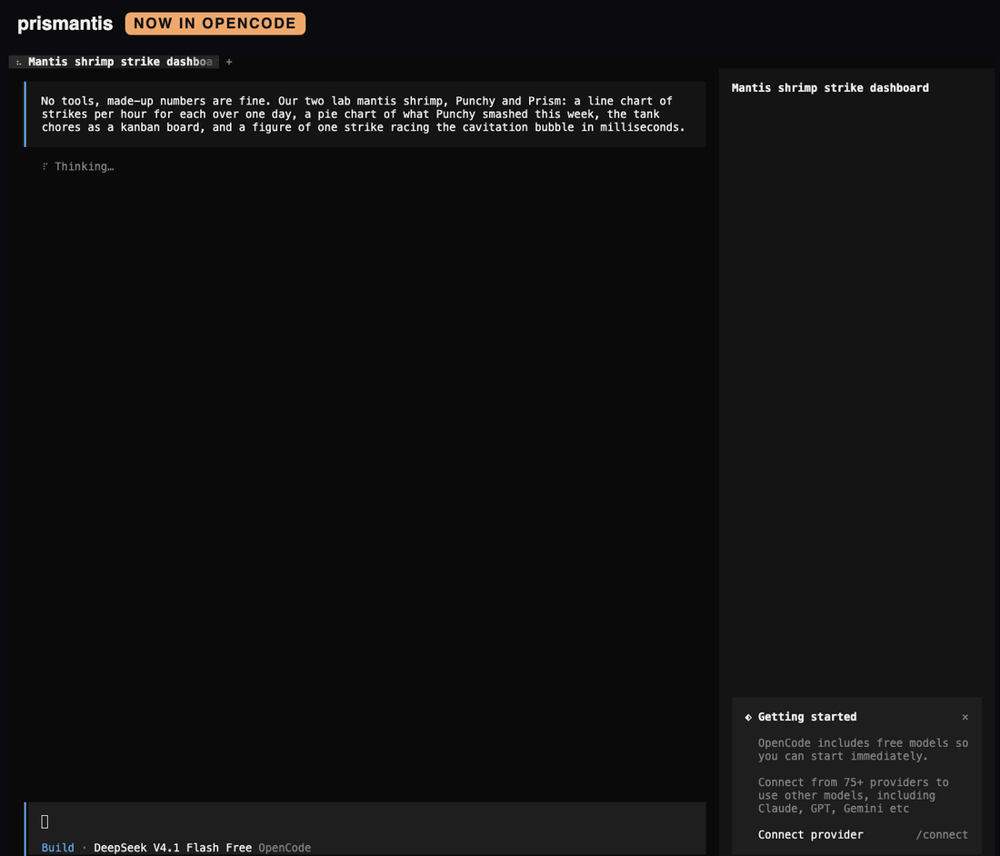

# prismantis for OpenCode

OpenCode lets a plugin draw its own fenced blocks, so prismantis in OpenCode draws ```figure blocks in color and the mermaid kinds OpenCode leaves as source as ```chart blocks, gives OpenCode the same session note as Claude Code, so replies come back with tables, diagrams and figures, and ships 18 prismantis themes that color code and prose.



[▶ Watch it with sound](https://www.catchkill9.dev/video/prismantis-opencode.mp4) (22 seconds).

## Install

Needs OpenCode 2.2.5 or later.

```bash
opencode plugin add 'github:NahumLitvin/prismantis#v0.48.2::path:opencode'
```

Run `/prismantis-themes` to install the themes, and pick one in settings > Theme. `/prismantis` prints the demo.

## What works

| Feature | OpenCode |
|---|---|
| The session note: tables, diagrams and figures in replies | ✓ |
| Code, headings, bold, italic, quotes, lists and links in the theme colors | ✓ |
| Figures drawn with their colors | ✓ |
| Mermaid flowchart, sequence, state, gantt, gitGraph and timeline (drawn by OpenCode) | ✓ |
| xychart bar and line charts, pie, quadrantChart, mindmap, journey, kanban, classDiagram and erDiagram (drawn by prismantis as ```chart) | ✓ |
| Copy buttons, tool rows, diff cards, prompt styles, alert boxes, footnotes, right-to-left text | |

This folder is generated from the Claude Code source by `npm --prefix scripts run build:codex`. Edit the source, not these files.
